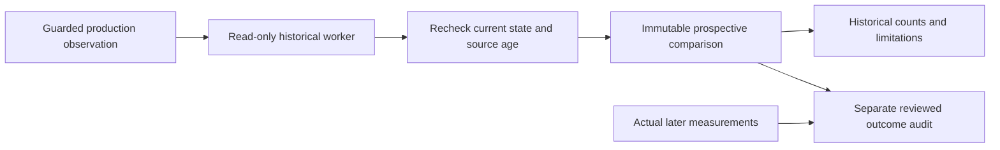

# Prospective Preview recording

The Pod can now retain predictive comparisons while the phone and browser are
closed. Collection starts and stops with the existing comfort Preview service.
It never changes the comfort mode, fits a model, sends a target, starts hardware,
or enables Active control.

## What gets recorded

At most once every five minutes per physical zone, the collector captures the
same production, occupied, quiet, room-supported observation and actual
five-minute predecessor used by the interactive comparison. Off and Active
modes do not collect. Missing or unqualified observations are not filled in.

A separate process opens both databases read-only and checks the existing
model artifacts and their reviewed references. It has a ten-second deadline,
128 MB JavaScript heap limit, bounded input/output and no hardware or service
entrypoints in its bundle. Only one child runs at a time. Historical inspection
does not hold an actuator lock or block the server event loop.

When the child returns, the live adapter rechecks the configuration, routine,
target, personal state and current guards. Changed state, Stop, a cancelled
process or an observation older than 15 seconds discards the result. The
original measured input remains the prediction origin: later measurements are
never substituted to make a forecast look more accurate.

The immutable local record includes its collection-run identity, source build,
hardware/occupancy/routine/room identities, observation time, original input,
model and dataset hashes, prediction ranges, policy choice and withholding
reason. `applied` is always false. Missing models can produce an honestly
withheld comparison; they cannot produce invented predictions. A content hash
detects changed or damaged records; it is not an external signature.

## Reading and retention

Autopilot's water-response area offers **Check Preview recordings**. It shows
the retained count, distinct routine sessions, hold/candidate/withheld counts,
last observation and current collector fault. A session count is not a complete
night count or a qualification result. The authenticated, no-store endpoint is
`GET /api/v1/comfort/predictive/recordings?side=left`; its only accepted input is
the side. Reading status neither starts collection nor writes records.

Records are retained for 30 days and inspected with row/byte limits. Samples
from rapid polling or service restarts are deduplicated. Historical records are
included in the existing physical-zone learning archive during household
transition, so they do not silently become Marissa's training data. The existing
personal/owner privacy boundary applies to the endpoint.

## What this does not prove

This delivers prospective **collection**, not a measured sleep benefit or an
active predictive controller. The separate [outcome audit](PREDICTIVE_OUTCOMES.md)
compares unchanged-target forecasts with later water measurements from reviewed
nights. A candidate that was not applied has no observed counterfactual outcome.
Holding the target and sleeping well does not validate that candidate. Actual
comfort feedback and unwanted adjustments still require separate assessment.

Software checks cover source identity, malformed/future/expired data, changed
settings during a pending read, cancellation, child timeout and read-only
packaging, restart deduplication, retention, API authentication, and phone/desktop
presentation. Synthetic test records are not live household recordings. Pod
deployment, overnight observation and physical qualification remain separate.
