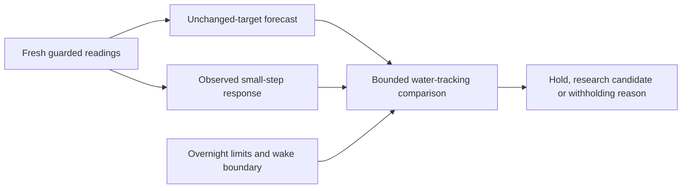

# Comparing a small temperature change with holding

`bounded-water-tracking-v1` is an inert research policy available from the web
Autopilot water-response section and authenticated
`GET /api/v1/comfort/predictive/preview?side=left` endpoint. It never sends a
temperature, starts a controller, fits a model, or enables Active comfort.

## Why this objective

[Eight Sleep describes Autopilot](https://www.eightsleep.com/autopilot/) as using
preferences, room conditions, workouts and sleep signals. Its public page does
not supply executable weights or a target-selection rule. Those product claims
cannot establish which adjustment improves this person's sleep on this Pod.

Our current evidence supports two narrower questions: water temperature if a
target stays unchanged, and observed water response after a recorded small
target change. This policy compares those predictions against the bounded
routine-and-feedback objective from the existing comfort policy. The objective is water
tracking, not an inferred body temperature, sleep stage, or optimal comfort.
The existing personal feedback offset still supplies the preference; the new
policy does not invent an adjustment from a workout or heart-rate change.

## Selection and withholding

- Read one actual, fresh, occupied, quiet Pod/room observation and its same-session
  five-minute predecessor. Both forecast registries revalidate their source
  reviews and matching sensor/routine configuration; unsupported predictions
  remain unavailable.
- Reapply the existing Preview, presence, water, manual-pause, vital-input,
  room-input, power, ownership, routine and 30-minute correction guards.
- Compare the current target with at most two adjacent integer targets. Each
  candidate stays inside both the owner's overnight limits and the existing
  three-degree routine-offset budget. A 70°F minimum excludes 69°F even when
  that prediction looks attractive.
- Require a complete 30-minute interval before the next scheduled temperature
  change, wake warming or routine end. No comparison crosses into the 105°F
  wake plan.
- For each horizon, calculate the smallest and largest absolute distance from
  the objective within each empirical prediction range. A changed target must
  beat holding even at its adverse range endpoint, after a fixed 0.25°F change
  penalty, by at least another 0.25°F at **both** horizons. These conservative
  policy constants are predeclared research choices, not learned sleep benefits.
- Select a research candidate only if exactly one direction passes. Ties,
  opposing wins and overlapping uncertainty retain the current target. Without
  a complete hold forecast the whole comparison is withheld.
- Expire the displayed result with the actual device reading, at most 15 seconds.
  A failed refresh, invalid response, different side or future timestamp removes
  the cached choice. Viewing or refreshing never replays a control request.

The comparison API accepts only a side. Client-supplied temperatures, model
outputs or activation flags are not accepted. The existing owner authentication
and no-store boundary apply to both REST and tRPC.

## What remains before control

This is a conditional research comparison. The background collector described
in [Prospective Preview recording](PREDICTIVE_RECORDINGS.md) now retains eligible
production observations without an open app. Neither path automatically updates the bed. The two observational
forecast models may have selection bias and their empirical ranges are not a
causal confidence guarantee. A candidate is therefore an experiment to consider,
not evidence that intervening will reproduce the estimate.

Next work must evaluate source-bound prospective decisions against subsequent
measurements, preserve unobserved counterfactual outcomes as unknown, and evaluate actual approved small
experiments, and review their comfort and unwanted-adjustment outcomes. Only a
separately qualified policy can join the single command authority. Native
collection-status presentation and personal-account exposure need their own
contract and privacy review before parity is claimed.

Validation covers guard failures, missing or malformed horizons, uncertainty,
ties, narrow limits, schedule/wake boundaries, expiry, authenticated reads,
no-write browser behavior, and phone/desktop layouts. Synthetic fixtures remain
illustrative; they are not personal training data or physical qualification.
