# Reviewing actual Preview nights

Autopilot → Personal comfort → **Preview night reports** separates the personal
baseline's qualified data dates from the owner's review of actual overnight
Preview sessions. No earlier check-in, imported sleep record, elapsed calendar
day or synthetic test is automatically counted as a Preview night.

```mermaid
flowchart LR
  Inputs[Current routine and observed Pod inputs] --> Preview[Existing Preview evaluator]
  Preview --> Journal[Atomic state and observation journal]
  Journal --> Report[Per-side report with provenance and gaps]
  Report --> Review[Owner reviews exact digest]
  Review --> History[Persisted review and source snapshot]
  History --> Progress[Current owner-confirmed night count]
  Progress --> Gate[Active remains unavailable]
```



## What a report says

A report groups one side's observations by the original routine identity,
start, end and timezone. Optional bed-entry shifts do not change those original
boundaries. It records runtime/build provenance, configuration changes, proposal
and reported-target ranges, eligibility and hold reasons, manual pauses, sensor
readiness, occupied checks and journal gaps. Reported targets are firmware
reports, not measurements of achieved water temperature or proof of movement.

The interval total sums **only adjacent checks at most 90 seconds apart**, within
the same runtime and calibrated sensor source. Both checks require fresh device
status, occupied classification with a matching calibrated person-level sample
no older than 30 seconds, and known quiet priming/vibration/base state. It does
not bridge restarts, source changes, missing data or gaps. This is sampled
evidence, **not measured sleep duration** or continuous observation.

A report can be confirmed when its routine window has ended, at least four hours
of those intervals exist, its source is still retained, and there are no clock,
identity or provenance problems. Four hours is an operational data-coverage
criterion, not a clinical definition of a sleep night. The owner must explicitly
confirm actual overnight use and review the report. Sensor-ready and eligible
proposal totals remain separate: legitimate holds can be reviewed without
claiming the sensor policy was ready or any adjustment occurred. Empty, stale or
mechanically uncertain periods cannot satisfy the occupied-interval requirement.

The runtime must identify itself as production and record a build revision from
`.git-info`. Development, test, missing-build and unidentified origins remain
inspectable but cannot qualify. Controlled fixtures simulate this contract only
in isolated test databases; their results never constitute real night evidence.

## Owner review and retention

The default conclusion is **Needs more observation or retest**. To count a report,
choose **Reviewed actual Preview night** and explicitly confirm overnight use.
Optional notes stay in the local configuration database. Reviews do not issue
commands, change settings, grant actuator leases or unlock Active—even at seven.

Each review binds the SHA-256 digest of the exact raw journal rows and the last
review ID. The transaction rechecks both after report parsing. A changed journal
or competing conclusion requires a refresh. An identical retry returns the
original review. A later retest conclusion removes that report from the count.
Source changes invalidate earlier conclusions rather than transferring them to
new observations.

- Existing journal limits remain 30 days and 50,000 observations per side.
- The list returns the latest 30 report identities by observation/review time.
  Progress describes this retained set, not a lifetime total. Duplicate local
  dates and overlapping routine windows count at most once.
- A report read admits at most 20,000 rows; larger reports require investigation
  instead of silently truncating evidence. Parsing yields every 256 rows.
- Detail pages contain 200 observations. Summaries show the top 20 reasons and
  first 20 gaps, plus the full gap count. Missing rows are never filled in.
- Review history and immutable summary snapshots retain up to 180 days and
  1,000 entries per side, pruned on review writes. Expired source leaves a
  historical review visible but cannot contribute to current night evidence.

Migration **0040** adds indexed report IDs to the existing journal and a review
table. Legacy rows retain null report IDs. Preserve a consistent pre-deployment
database backup: rollback to an earlier binary must restore its matching
database and optional JSON-state schema, not reuse newer migrated data.

## Native and web API contract

Use the existing owner Bearer credential or browser session. Reads never start
the runtime or hardware. OpenAPI contains full response schemas.
`GET /api/v1/comfort?side=left` advertises optional
`features.nightReports: true`; absent or false means unavailable.
`features.followBedtime` remains separate.

| REST route | Input | tRPC procedure |
| --- | --- | --- |
| `GET /api/v1/comfort/reports` | `side` | `comfort.reports` |
| `GET /api/v1/comfort/report` | `side`, 64-hex `id`, optional positive `afterId` | `comfort.report` |
| `POST /api/v1/comfort/report/review` | JSON shown below | `comfort.reviewReport` |

```json
{
  "side": "left",
  "id": "<64-hex report ID from the server>",
  "digest": "<64-hex digest from the inspected report>",
  "expectedReviewId": null,
  "outcome": "needs_retest",
  "confirmedActualNight": false,
  "note": "Inspect the gaps before another observation session."
}
```

Use the latest `review.id` instead of null when replacing a review. `outcome`
accepts `reviewed` or `needs_retest`; `reviewed` requires explicit true
confirmation. Notes are trimmed and limited to 2,000 characters. Side is required
on every call; report lookup is side-scoped. Timestamps are epoch milliseconds;
display dates use the recorded timezone.

List responses include `apiVersion: 1`, `generatedAt`, `side`, `items`,
`targetNights: 7`, `ownerConfirmedNights`, `activationAvailable: false`. Each item
includes `summary`, nullable `review`, `reviewCurrent` and
`countsAsOwnerConfirmedNight`. Detail adds `observations` and nullable
`nextAfterId`. The list's deduplicated count is authoritative; do not sum item
flags. `summary.state` is `collecting`, `closed` or `source_expired`.

HTTP 400 indicates invalid input; 404 means no report for that side; 409 requires
refreshing changed evidence or a competing review; 412 means unfinished or
insufficient evidence. Malformed storage fails closed. Missing owner credentials
return 401 on REST and tRPC. Failed refreshes must not appear as fresh progress.
When paging, retain the report digest and discard prior pages if it changes.

**There is no `/api/native/v1` forwarding layer in this Core revision.** Native
clients must call the authenticated routes above directly and negotiate their
features. `nativeCompatibility` remains null. Optional `timing` fields from
[bed-entry Preview](BED_ENTRY_PREVIEW.md) likewise use the direct comfort API.
Do not infer availability from older migration planning documents.

## Verification boundary

SQLite, runtime, API and browser tests exercise sparse/stale/ambiguous evidence,
mechanical interference, restarts, source changes, clock reversal, atomic review
failure, concurrent journal changes, retention, paging, side isolation and exact
review conflicts. Seven synthetic reviewed dates still leave Active unavailable.
Browser screenshots and tests use isolated databases and no Pod commands. They
do not demonstrate physical qualification, actual overnight use, Watch agreement
or improved sleep. Attended migration, hardware qualification and real Preview
nights remain separate release gates.
