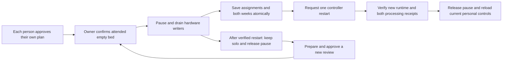

# Reviewed two-person activation

The owner and joining person can prepare and independently approve their sides
and complete weeks. Once the controller is explicitly configured to offer the
attended workflow, the owner can start the side change from web or native apps.
The existing coordinator, durable pause, restart and recovery checks remain the
only authority. Reading a capability or review never contacts or moves hardware.

## Availability and ownership

All six deployment options must equal `1`: `SLEEPYPOD_HOUSEHOLD_PREPARATION`,
`SLEEPYPOD_PERSONAL_RUNTIME`, `SLEEPYPOD_PERSONAL_ROUTINES`,
`SLEEPYPOD_PERSONAL_HISTORY`, `SLEEPYPOD_ARRANGEMENT_REVIEW`, and
`SLEEPYPOD_ARRANGEMENT_ACTIVATION`. This release does not change those options on
an installation. Enabling them does not start a transition.

The session advertises activation only to an authenticated owner in solo mode,
with open hardware admission and no unresolved transition. Missing or corrupt
admission state withdraws that capability. A review additionally needs both
current independent approvals, the same household/Pod/sleeper/assignment and an
unexpired validity window. Changed settings and revoked approving devices
invalidate the review through the existing snapshot validation.

Availability means the software supports an attended attempt. It is not a claim
that the bed is empty or physically ready. The mutation still checks the current
approved plan, recording source, attribution, original service generation,
fresh sensor readings and explicit attended confirmations before holding and
again before committing.

## The complete sequence

An interruption keeps the saved pause and receipt. A lost activation response
allows receipt reads only; an absent receipt does not offer another activation
in that maintenance session. Restart requests are persisted before dispatch and
cannot be automatically repeated.

Completed cancellation stays visible. A later attempt requires a different
review, created after that cancellation, fresh independent approvals and fresh
attended confirmations. It receives a new operation ID; the original receipt is
retained. Old, still-pending or unknown attempts never qualify as a cancellation.

After assignment, the consumed solo proposal stays in storage. It is no longer
returned as the latest proposed arrangement, and preparation is disabled for that
assigned session. Recovery remains available to the original owner device.
Personal controls must reload the new assignment; stale controls are not reused.

## Evidence and remaining delivery

The authenticated integration test runs the real browser workspace through the
real HTTP handler, migrated SQLite stores, coordinator, assignment commit,
restart request and recovery. External service identities, physical observations
and restart effects are simulated. A second test interrupts the first attempt,
completes cancellation, preserves its receipt and starts a newly approved review.
Other cases cover opt-in prerequisites, owner/member boundaries, expired/changed/
revoked reviews, missing admission and no hardware side effects from reads.

Web and native regressions cover the two recovery boundaries: new review after
verified cancellation, and read-only recovery after an uncertain activation.
These checks do not establish deployment, TestFlight delivery or physical
two-person acceptance. Solo-anywhere remains the live arrangement until an
explicitly reviewed attended activation with Marissa.

See [the transaction and recovery contract](HOUSEHOLD_ARRANGEMENT_COMMIT.md) for
the preservation, processing and physical evidence requirements.

Local validation passed the 807-test household suite before the final additional
cancellation lifecycle case, followed by all 40 focused HTTP/workspace checks,
eight browser maintenance scenarios, TypeScript, focused lint and the production
build. The independent web finish review returned `ship` for desktop and enlarged
phone text. Native, hosted and physical acceptance remain separate.
