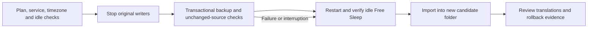

# Prepare current Free Sleep data for an attended migration

`scripts/deployment/prepare_data.py` replaces revision-specific preparation
snippets with a reproducible capture and review step. It never starts Core,
selects a boot controller, replaces live data or accepts migration warnings.
It **does stop and restart Free Sleep's two writers**, so run it only during
the approved attended idle window with no impending routine or alarm.



Use the locked migration interpreter, the exact reviewed deployment/migration
sources and their SQL journals. The backup program remains the companion
Free Sleep repository's `scripts/migration/backup.py`; inspect that revision
and obtain its SHA-256 independently before transfer. The command verifies
that digest before stopping services and again before executing the program.
Do not obtain the expected digest from an unreviewed downloaded file itself.

```sh
/private/migration-env/bin/python /reviewed/core/scripts/deployment/prepare_data.py capture \
  --plan /persistent/sleepypod-unified/service-plan-REVIEWED \
  --legacy-data /persistent/free-sleep-data \
  --backup-tool /private/reviewed-free-sleep-backup.py \
  --backup-sha256 REVIEWED_64_CHARACTER_SHA256 \
  --output /persistent/sleepypod-unified/new-quiesced-preparation
```

The existing plan must match installed, disabled Core units and the original
enabled Free Sleep units. A live/unfinished Core handoff, active Core service,
changed unit definition, active heating/priming/vibration, unavailable timezone,
wrong backup digest, existing destination or overlapping application/data path
fails before downtime. The command takes the same plan lock as trial/activation.

After both legacy control groups have stopped, capture verifies that settings,
routines, baselines, comfort history and journal are unchanged and match the
backup manifest. Missing optional sources are also compared: an added journal
cannot be silently omitted. If a writer restarts or source changes during
capture, the attempt fails and the new files remain for investigation.

Free Sleep is restored **before** running the importer. Even a disk-full error
does not put a journal write ahead of the restart attempt. Restoration verifies
the original unit identities, active processes, enabled state and idle API
report. It sends no corrective temperature, power, vibration or base command.
An unexpected physical effect still needs the nearby owner's report.

The output is private and contains:

- `backup/`: original data/private archives and their manifest.
- `candidate/`: the full current importer output, including all three databases,
  preserved originals and source archives. Credentials stay in the private archive.
- `preparation.json`: durable phase, source/tool identities, capture/restoration
  times and review-report hash. `readyForCutover` remains false.
- Private capture/import logs. Do not publish them or the source archives.

The importer verifies every archive entry/checksum and applies the checked-in
database journals; there are no fixed routine counts, migration numbers or
accepted-warning lists in this command. All translation warnings remain in
`candidate/migration-report.json`. Import failure occurs after Free Sleep has
recovered, and does not remove the captured rollback files.

## Recovery and subsequent review

Ordinary exceptions and SIGINT/SIGTERM/SIGHUP enter restoration. A power loss,
uncatchable kill, changed services or service-manager failure can still leave
the operation interrupted. Inspect `preparation.json` and restore only the
original services with the same reviewed plan:

```sh
/private/migration-env/bin/python /reviewed/core/scripts/deployment/prepare_data.py recover \
  --plan /persistent/sleepypod-unified/service-plan-REVIEWED \
  --output /persistent/sleepypod-unified/new-quiesced-preparation
```

Recovery refuses a different plan/service identity or a completed preparation.
It never recaptures, imports, resumes Core or copies a database. Keep the original
installation/SSH and separate installation/Bluetooth recovery archives intact.
No command here proves a restored boot image or physical thermal operation.

Copy the backup off-host and verify it. Review enabled routines and alarm
warm-up/hold differences, temporary overrides and pending calibration. A
separate explicit data promotion must preserve the current candidate and copy
**all three** database files plus the report and required original data; keep
credential archives outside Core's runtime data. Do not point a service at the
preparation folder or copy over an open SQLite database. Use the documented
[controller handoff](CONTROLLER_HANDOFF.md) only after that review.

The activation preflight requires the separate history database and its
byte-preserved original. It checks the import checksum, stored provenance,
SQLite integrity and absence of history sidecars. A partial two-database copy,
substituted snapshot or old report without history evidence is refused before
Free Sleep is stopped. The live history that Free Sleep continues writing is
not compared against this dated snapshot.

Free Sleep resumes writing after capture. The candidate is a dated snapshot,
not synchronization; activation must recheck original configuration, and a new
quiesced capture is needed if the owner wants later history included. This
workflow does not count as an attended Core trial, physical qualification or
any of the seven required Preview nights.

The deployment test suite uses temporary synthetic data, real importer SQL
and simulated systemd/API responses. It covers capture/import order, preserved
data, drift, interrupted work, disk-full restoration and recovery ownership.
No test starts an actual controller.
