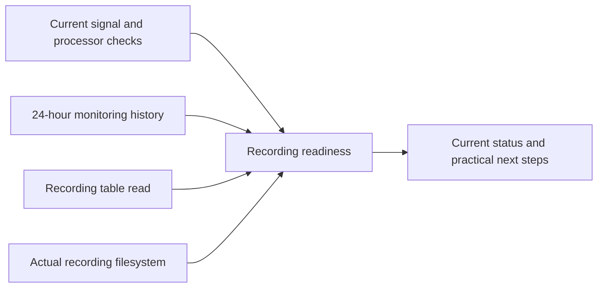

# Recording readiness

Part of approved platform improvement 05. The Temperature cards and Sleep page
now show a read-only recording check before the next night. The same authenticated
REST/tRPC contract is available to native clients at `GET /api/health/recording`.

The checks cover presence frames, piezo frames, the sleep/vitals processors,
configuration database health, independent access to the recording table, available
recording storage and repeated presence-signal interruptions. Empty-bed processor
idle states are expected. Missing, stale or future-dated evidence cannot produce
an all-clear. A lost browser connection withdraws the current readiness label and
retains the previous result explicitly as history.

The collector reads the filesystem containing the actual biometrics SQLite file.
It warns below 256 MiB or 5% free space. These are operational headroom thresholds,
not a forecast of how many nights will fit. The check never deletes recordings,
cleans storage, changes calibration, restarts a service or writes to the bed.
Concurrent requests share one collection with a maximum 15-second response cache.
The view refreshes while open every 30 seconds and rejects checks older than
60 seconds. The response expires with its oldest underlying observation, so
fetching a cached check never extends its freshness. It observes the existing
sampler's latest check without opening a
hardware connection or initializing a scheduler. Startup remains unverified until
that sampler publishes. Existing health-history monitoring supplies the previous
24 hours.

Two or more recorded presence-signal interruptions prompt investigation. This is
missing frame evidence, not proof that someone woke or left the bed. Healthy frame
delivery cannot prove that the occupancy classifier is correct: middle-of-bed and
left/right physical qualification remains separate. Watch imports, model quality,
push notifications, per-person classification-dropout analysis and native views
are not established by this endpoint. Unknown monitoring intervals remain unknown.

## Verification

Focused tests cover missing/future sources, healthy empty-bed idle states,
independent database failures, storage thresholds, repeated signal interruptions,
cache expiry, clock rollback, concurrent reads, failure isolation and read-only
collection. Component tests cover truthful stale/error presentation and actionable
details without repair buttons. Browser tests verify authentication, private cache
headers, isolated-source readiness and loss of connectivity at mobile/desktop sizes.

On 10 November 2026, the 36 focused tests and all three production browser tests
passed. The browser cases cover 390px and 1440px layouts, anonymous rejection,
private response headers, a failed recording source, and complete connection loss.
The last case correctly withdraws the private web screen through the existing
connection gate. Screenshots of both layouts were inspected. The production build,
TypeScript and focused ESLint checks passed using Node 24.

The complete regression run passed 8,820 tests across 628 files, with 19 existing
environment-dependent tests skipped. No timeout or assertion was relaxed. Earlier
contention-related timeout failures and fixture failures remain in local logs;
the final run used two workers without a concurrent build. Its receipt is
`/tmp/sleepypod-recording-final-regression.log`.

This feature has not been activated on the physical Pod by this change.
