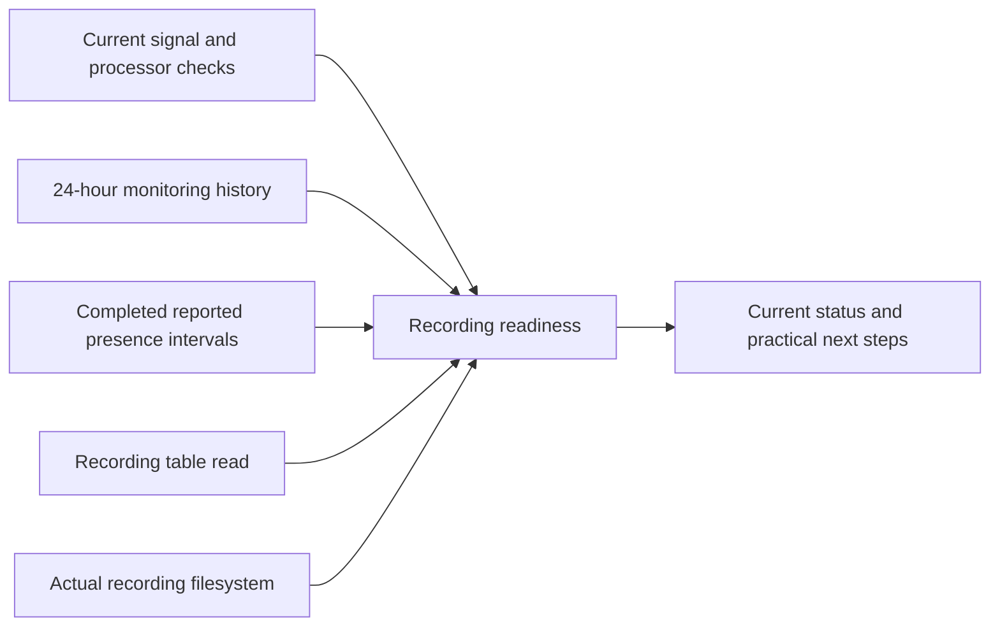

# Recording readiness

Part of approved platform improvement 05. The Temperature cards and Sleep page
now show a read-only recording check before the next night. The same authenticated
REST/tRPC contract is available to native clients at `GET /api/health/recording`.

The checks cover presence frames, piezo frames, the sleep/vitals processors,
configuration database health, independent access to the recording table, available
recording storage and repeated presence-signal interruptions. Empty-bed processor
idle states are expected. Missing, stale or future-dated evidence cannot produce
an all-clear. A lost browser connection withdraws the current readiness label and
retains the previous result explicitly as history.

The collector reads the filesystem containing the actual biometrics SQLite file.
It warns below 256 MiB or 5% free space. These are operational headroom thresholds,
not a forecast of how many nights will fit. The check never deletes recordings,
cleans storage, changes calibration, restarts a service or writes to the bed.
Concurrent requests share one collection with a maximum 15-second response cache.
The view refreshes while open every 30 seconds and rejects checks older than
60 seconds. The response expires with its oldest underlying observation, so
fetching a cached check never extends its freshness. It observes the existing
sampler's latest check without opening a
hardware connection or initializing a scheduler. Startup remains unverified until
that sampler publishes. Existing health-history monitoring supplies the previous
24 hours.

Two or more recorded presence-signal interruptions prompt investigation. This is
missing frame evidence, not proof that someone woke or left the bed. Healthy frame
delivery cannot prove that the occupancy classifier is correct: middle-of-bed and
left/right physical qualification remains separate. Watch imports, model quality,
push notifications and per-person classification accuracy are not established by
this endpoint. Unknown monitoring intervals remain unknown.

## Repeated short reported breaks

The existing `presence-history` check also reviews explicit present/absent JSON
intervals in completed `sleep_records`. The eight check identities and v1 response
remain compatible with native clients. Policy `completed-interval-breaks-v1`
flags three or more 30–120-second reported absences beginning within one rolling
hour, inside the trailing 24 hours. This is a provisional review heuristic, not a
validated false-exit detector: genuine exits and inconsistent sensing can produce
the same pattern. A flag asks the user to compare the record with the actual night.

An absence must have a recorded presence interval ending exactly at its beginning
and another starting exactly at its end. The review never infers exits between
separate records. Duplicate/overlapping intervals are unioned, contradictory
evidence is excluded, and malformed/missing or future intervals leave incomplete
evidence explicit. Python floors the SQL record bounds but retains fractional
JSON times; valid fractional edges are preserved. The analysis neither rewrites
recordings nor changes calibration or detector decisions.

The read uses the existing side/entry-time index, at most 200 candidate rows per
side, 64 KiB per interval field and 2 MiB of JSON in total. Each field allows at
most 2,000 intervals, with 8,000 combined intervals per side. Exceeding a limit
reports partial evidence and cannot produce an all-clear. An unavailable, stale,
empty or incomplete review also cannot make the combined check ready. Reliable
positive clusters still prompt review when another source is unavailable.

This review covers completed records only. An unfinished night is not included;
the current sensor and processor checks remain independent. In solo-anywhere mode
one recording stream can combine both physical zones. Neither a stream nor an
occupancy interval identifies a person, proves sleep or establishes uninterrupted
sensor coverage. The detector can hold a debounced state through missing samples;
we therefore do not describe its intervals as signal coverage. Live checkpoint
analysis and per-person classification validation remain separate work.

## Verification

Focused tests cover missing/future sources, healthy empty-bed idle states,
independent database failures, storage thresholds, repeated signal interruptions,
cache expiry, clock rollback, concurrent reads, failure isolation and read-only
collection. Component tests cover truthful stale/error presentation and actionable
details without repair buttons. Browser tests verify authentication, private cache
headers, isolated-source readiness and loss of connectivity at mobile/desktop sizes.

On 10 November 2026, the 36 focused tests and all three production browser tests
passed. The browser cases cover 390px and 1440px layouts, anonymous rejection,
private response headers, a failed recording source, and complete connection loss.
The last case correctly withdraws the private web screen through the existing
connection gate. Screenshots of both layouts were inspected. The production build,
TypeScript and focused ESLint checks passed using Node 24.

The complete regression run passed 8,820 tests across 628 files, with 19 existing
environment-dependent tests skipped. No timeout or assertion was relaxed. Earlier
contention-related timeout failures and fixture failures remain in local logs;
the final run used two workers without a concurrent build. Its receipt is
`/tmp/sleepypod-recording-final-regression.log`.

This feature has not been activated on the physical Pod by this change.

The completed-interval follow-up passed 270 focused tests across 29 files,
TypeScript, scoped ESLint and the production build on Node 24. Its five browser
checks cover authenticated access, unchanged recordings, clustered-break messages,
390px/1440px rendering, source expiry and connection loss. Screenshots of the
warning and scrolled detail were inspected. The first test run caught an overly
broad assertion that disallowed reporting zero breaks even in explicitly labelled
usable partial evidence; the final test requires both the limited scope and the
unknown state. The original failed run is retained. This is software evidence;
no physical classification accuracy or improved sleep recording is established.

Two additional advancing-clock demo regressions passed after fixing observation
ordering: the recording and bed-care evaluations now occur after their sources
are collected, so valid example readings are not rejected as future evidence.
