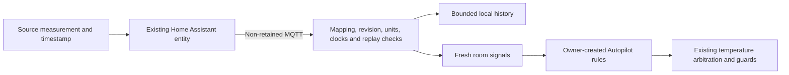

# Home Assistant room measurements

Home can now display mapped temperature, humidity, CO₂, fine-particle (PM2.5)
and light measurements. Input is disabled by default. This is a sensor adapter;
it does not pair accessories, change Apple Home pairings, create an Autopilot
rule, or issue commands to a humidifier, purifier, light or bed.



## Setup

1. Configure the existing MQTT connection in Settings. Use private networking,
   authenticated broker accounts and topic ACLs. TLS retains certificate checks
   unless the separate self-signed option was deliberately configured.
2. In Home → Sensor mapping and setup, select an existing `sensor.*` entity,
   its actual unit, and an attribute containing its source measurement time.
   Inspect the integration and Developer tools → States to verify that attribute.
   It must advance for new measurements, including unchanged values, and must
   not advance just because a cached state was polled or restored.
3. Select ISO 8601 with timezone, Unix seconds or Unix milliseconds to match
   that attribute. Set maximum age (30–900 seconds) to the sensor's reporting
   cadence. If no trustworthy timestamp exists, leave the sensor unmapped.
4. Save, then generate sensor publishers. Create one empty Home Assistant
   automation for each document, choose Edit in YAML and paste the document.
   JSON is valid YAML. Each document publishes only that entity, on changes and
   every 30 seconds, preserving the original source timestamp. Replace previous
   publisher documents after **every** configuration save.
5. Enable mapped room input when the source mapping is verified. A new sample
   must arrive before the reading becomes fresh. This does not activate any
   Autopilot rule. Review rules in Preview first; hardware qualification and
   adaptive-activation gates remain separate.

Do not substitute `now()`, `last_changed`, `last_updated`, or `last_reported`
for an unavailable measurement timestamp. HA's reported timestamp tracks state
writes rather than physical sampling, and MQTT may replay retained states or
suppress unchanged state writes. [HA state-report semantics](https://contributors.home-assistant.io/blog/2024/03/20/state_reported_timestamp/),
[HA MQTT state updates](https://www.home-assistant.io/integrations/mqtt/#the-last-reported-state-attribute).
An attribute named `last_seen` is only an example, not a universal guarantee.

## Topic and payload

Core subscribes to exactly `<prefix>/<device-id>/room/report`; the current
resolved topic is returned by the owner API after subscription acknowledgment.
The home publisher account should have write permission only on this topic;
Core needs read permission there. Pod telemetry uses the existing outbound
topics. Room input does **not** require `MQTT_COMMANDS_ENABLED`; keep that
actuator permission off unless separately needed and qualified.

One JSON object per report (all clocks are UTC epoch milliseconds):

```json
{
  "schemaVersion": 1,
  "source": "home_assistant",
  "revision": 1,
  "metric": "temperature",
  "entityId": "sensor.example_bedroom_temperature",
  "unit": "°C",
  "reportedAt": 1793000000000,
  "measuredAt": 1792999999000,
  "available": true,
  "value": 20
}
```

This is an illustrative historical payload; it must not be replayed as current.
An unavailable report has `available:false`, `value:null`, `measuredAt:null` and
a current publisher `reportedAt`. No HTTP endpoint accepts sensor reports.

The store rejects unknown fields, wrong revisions/entities/units, non-finite or
out-of-range values, future clocks, publisher age ≥30 seconds, measurement age
at or beyond the configured limit, payloads over 2 KiB, retained/duplicate MQTT
packets, and older/equal timestamps. Repeating a sample with a new publisher
clock cannot extend its expiry. Both source clocks must be synchronized.
At most one accepted report per sensor per five seconds is persisted; an
unavailable transition still withdraws a fresh sample immediately.

Replay watermarks persist across restarts. A broker disconnect or process
restart clears live eligibility; cached history never repopulates it. A new
measurement is required after reconnect. Malformed messages are ignored rather
than trusted as an availability update; any previous sample keeps its original
expiry. A valid unavailable report withdraws it immediately.

## Native and web API (version 1)

All endpoints require the existing owner bearer credential or browser session.
Configuration contains private entity names, but no Home Assistant bearer token
or broker password. Do not export household entity identifiers into public source.

| Method / path | tRPC | Result |
|---|---|---|
| `GET /api/v1/home/context` | `roomContext.status` | `apiVersion`, `generatedAt`, `revision`, `config`, `connected`, `topic`, `observations` |
| `PUT /api/v1/home/context/configuration` | `roomContext.configure` | Send `{expectedRevision,config}`; returns `{revision,config}`; stale revision is HTTP 409 |
| `GET /api/v1/home/context/history?beforeId=…` | `roomContext.history` | Up to 200 newest rows, stable `nextBeforeId`, original clocks, source entity, normalized unit/value and configuration revision |
| `GET /api/v1/home/context/publisher` | `roomContext.publisher` | `{revision,automations:string[]}`; each string is one JSON/YAML automation; disconnected broker returns HTTP 412 |

Config: `{enabled,roomName,mappings}`. Each mapping contains `metric`, `entityId`,
`unit`, `timestampAttribute`, `timestampFormat`, `maxAgeSeconds`. Up to five
mappings; entity IDs and metrics must be unique. A full save increments revision,
withdraws live readings and invalidates the previous publisher even if fields
appear unchanged. Read after an ambiguous save; do not blindly retry it.

Observation status is `fresh`, `disabled`, `disconnected`, `waiting`,
`unavailable`, `stale`, or `clock_invalid`. Only `fresh` includes a live `value`.
`lastValue` is historical context, never a live fallback. Show unit, entity,
`measuredAt` and expiry. `connected` means the subscription was acknowledged,
not that any sensor or accessory is online. Poll while foregrounded, hide live
values on read failure, and expire them locally between polls. The web also
withholds values after 15 seconds without a successful status refresh.

History retains up to 30 days **or 25,000 accepted reports**, whichever is
smaller. Purging happens on ingestion; reads exclude expired/future rows even
without new data. Latest watermarks remain separately persisted. History is
available for reports/export; historical Autopilot backtest overlays are not
connected to this data source yet.

## Automation and capability boundaries

Signals: `room.temperature` (°F), `room.humidity` (%), `room.co2` (ppm),
`room.pm25` (µg/m³), `room.light` (lx). These never replace `ambient.*` readings
from the Pod. The existing rule engine withdraws dependent policies when live
input disappears, including rules with older window samples. Configuring room
input does not add or activate rules and cannot bypass the temperature arbiter,
manual hold, water, priming, freshness or other existing actuator guards.
`features.homeContext.implemented` is true; runtime becomes ready only while at
least one mapped measurement is fresh. It does not certify physical sensors.

House Control remains the authority for accessory capability mappings: the
saved diffuser mapping supports power only, and the purifier exposes discrete
fan settings. No additional writable capabilities are inferred here. Household
accessory actions and scene templates remain separate, inactive workstreams.

## Verification boundary

SQLite and real loopback MQTT tests cover source timestamps, units, replay,
restart, disconnect, availability, retention and policy withdrawal. Production
browser checks exercise authentication, mapping conflicts, disabled/default
state and responsive Home controls. These are synthetic local checks. Real HA
entity timestamp qualification, publisher import, broker ACLs, Pod rollout and
attended hardware checks are still required. Neither an API acknowledgment nor
a successful fixture proves a physical sensor or actuator works.
