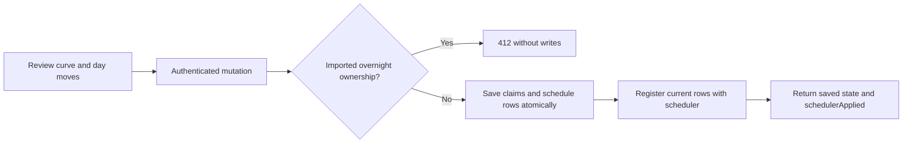

# Schedule library and overnight ownership

Reviewed integration of upstream `a9d10d456dd250c2060c330715a9c0bbc1238f76`,
adapted to preserve Free Sleep's complete overnight routines and paused rows.

Named calendar curves hold set points in Fahrenheit, an end action, notes,
selected weekdays for each side, and an active flag. At most one active curve
claims a given side and calendar day. Activating another curve moves overlapping
days atomically; a curve with no remaining days becomes inactive. The web editor
shows those moves before submitting. Alarms remain separate and unchanged.

## Client contract

Discover `features.curveLibrary.implemented` using `/api/v1/capabilities`.
All routes require the existing owner credential or browser session.

| Method and path | Behavior |
| --- | --- |
| `GET /api/curve-templates` | Lists named curves, including `days: { left, right }`, `active` and `endAction`. |
| `PUT /api/curve-templates` | Creates a curve, or updates by optional positive `id`; writes its days and active flag atomically. Returns `{ curve, moved, schedulerApplied }`. |
| `POST /api/curve-templates/active` | Accepts `{ id, active }`; moves overlapping claims when enabled. Returns the same change envelope. |
| `POST /api/curve-templates` | Legacy save by name; retains existing days and active state, rewrites its rows if active. Returns the curve with `schedulerApplied`. |
| `DELETE /api/curve-templates?name=...` | Removes the named curve's active claims and calendar rows. Returns `{ deleted, schedulerApplied }`. |

The PUT payload includes `name` (1–30 characters), `bedtime`, `wake`,
`points` (2–48 unique `HH:mm` keys with temperatures), `notes`,
`endAction` (`turn_off` or `maintain`), `days`, and `active`. An active request
without days is stored inactive; explicitly enabling a dayless existing curve
returns 400. Duplicate names return 409. The `moved` entries identify affected
curve names, sides, days and whether each curve became inactive.

These are calendar weekdays, **not bedtime-owned nights**. The server refuses
any rewrite on a side containing imported bedtime ownership or explicit next-day
power offsets. That includes activation, editing an active curve or clearing its
rows. It rolls back both sides, claims and metadata if either side is protected.
Save an inactive template without changing schedules, or use `/api/v1/routines`
to edit an imported night. The web UI retains the complete-bedtime editor for
those sides. Library support does not convert existing overnight routines.

An edit to an active curve preserves matching rows' enabled states; new points
on a fully paused day also stay paused. An explicit off/on cycle recreates that
curve's rows enabled. Existing global, away and schedule-group guards still
apply. Individual calendar-row edits release that day from the library when
they change its content; enabled-only edits retain its claim.

`schedulerApplied: false` means the database save committed but scheduler
registration failed. The UI reports the pending registration; inspect controller
diagnostics before relying on that schedule. `true` means the operation's job
registration completed, or no registration changes were needed. It does not
prove a future job will execute or that hardware moved, heated or vibrated.
After delayed scheduler startup, registration reads current rows instead of
reviving deleted rows or overwriting a newer edit. Existing scheduler liveness
reconciliation remains the recovery path.

Library mutations have no expected-revision input or durable command receipt.
The displayed day-move review is a snapshot; concurrent clients can change
claims before submission. The server's returned `moved` list is authoritative.
Do not promise stale-editor rejection equivalent to `/api/v1/routines`.

## Migration and validation

Generated migration 0035 adds library metadata. Migration 0036 leaves a marker
for one-time adoption of compatible unmanaged calendar schedules. Adoption adds
claims without rewriting the schedule rows. It skips entire sides with bedtime
ownership or explicit next-day power offsets. Adoption and marker removal share
a transaction; failure retains the marker for the next start and leaves the
existing schedules usable. Back up databases before upgrading; use the saved
installation and pre-upgrade databases together when rolling back.

Behavioral coverage includes claim moves, transaction rollback across sides,
paused rows, independent alarms, scheduler failure, concurrent scheduler startup,
demo parity, migration retry, authenticated browser saves and reloads. The
browser runner creates isolated fixture databases; it does not connect to a Pod.

On 2026-10-25 an offline upgrade of a private backup of the snooze rehearsal
preserved all 14 imported routines and every temperature, power and alarm row.
Integrity and TypeScript ownership checks passed; no imported side was adopted
into the calendar library. Both source database hashes remained unchanged.
The aggregate private record is
`~/Downloads/SleepyPod-Library-Rehearsal-2026-10-25/library-verification.json`.
No controller was started and no hardware command was sent during that rehearsal.
