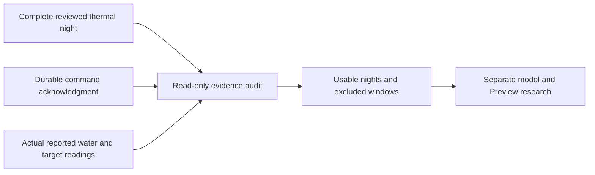

# Learning from actual target changes

This is the evidence-collection part of approved improvement 08. It is not a
predictive controller, fitted target-change model, or demonstration of better
sleep. The existing water forecast assumes an unchanged target. This additional
read-only audit asks a different question: after an acknowledged small change,
what did the Pod actually report 15 and 30 minutes later?

## Evidence and boundaries

`GET /api/v1/comfort/response?side=left` and the equivalent `comfort.targetResponse`
tRPC query require the existing owner connection/session authentication. The
response is versioned and private/no-store. No personal-account permission,
mutation, background collector, model fit, power-on or hardware call is added.
The Autopilot water-forecast section reads it only when the user selects **Check
recorded changes**. Cached counts withdraw on read failure, refresh, side mismatch,
invalid output or expiry; expiry is checked on the existing minute clock.

A window requires all of the following:

- A complete, source-matched owner-reviewed thermal night and morning check-in,
  using the existing collection policy. Its configuration matches the most recent
  reviewed hardware/schedule/room configuration. Historical Health sleep totals
  cannot substitute for missing Pod measurements.
- One ordinary scheduled or automatic reconcile changing the reported target by
  exactly 1°F. Manual changes, power-on, wake warming and unresolved acknowledgments
  are excluded. A command acknowledgment is not proof of heat reaching the sleeper.
- A durable acknowledgment within 30 seconds, followed by an actual firmware
  target report within 90 seconds. Power, target and water observations must cover
  ten minutes before and thirty minutes after the change, with no gap over 90
  seconds. Another target change or unresolved command excludes the window.
  Confirmed same-target keepalives are allowed.
- Actual 15- and 30-minute water outcomes within 45 seconds of each horizon.
  Previous water, five-minute water trend, room temperature and humidity features
  precede dispatch. Future water readings only supply outcomes. Room context must
  cover the window without a gap over 330 seconds; room variation must stay within
  2°F and humidity within 10 percentage points of the preceding context.
- Quiet occupied observations from the physical zone. Solo-anywhere occupancy
  does not identify whose body caused a response or qualify the other half's water
  as that sleeper's exposure. The audit explicitly says `physical_zone_only`.

The audit reads retained evidence rather than changing normal schedules to acquire
more samples. Users should not make unnecessary temperature changes to reach a
count. Twenty distinct usable nights is only an initial collection milestone.
Many samples from one night do not become many independent nights.

## Read limits and reproducibility

The source thermal audit examines up to 90 feedback nights and 50,000 retained
thermal-context events. This additional audit reads at most 1,001 command metadata
rows per night (a 1,001st row excludes the night), 1,000 bounded command payloads
per night, 64 KiB per payload and 4 MiB total payload bytes. More than 64 changes
excludes the night. Water queries read at most 301 rows per candidate (a 301st row
excludes it), stop before a query would exceed 50,000 rows in total, and use the
side/timestamp index. The command journal's existing retention is 30 days.
Malformed or truncated evidence is not interpreted as successful recording.

Each accepted response binds the reviewed source proof, full source night, command
receipts and actual water samples into its digest. A changed/withdrawn owner review
or missing outcome withdraws the window. Output includes the dataset digest,
counts and up to 300 exclusion summaries. There is no stored model and no new
persistent state or database migration.

## Research rationale and remaining work

Eight Sleep's published Autopilot description uses personal history, temperature
preferences, ambient conditions and feedback. Its public description does not
provide model weights or a transferable controller for this installation.
[Official description](https://www.eightsleep.com/blog/smart-temp-autopilot/).

Observed target responses are selected by the existing controller and by quality
filters; they do not establish randomized causal effects or comfort benefits. A
future fitted model must keep whole nights separated chronologically for fitting,
error calibration and evaluation, compare against simple baselines, and withdraw
predictions outside measured conditions. Repeatedly tuning against the final test
set would invalidate that evaluation.
[scikit-learn evaluation guidance](https://scikit-learn.org/stable/modules/cross_validation.html).

Predicting water response and improving comfort are separate objectives. After
response validation, Preview can compare bounded proposals. Actual activation
still requires reviewed proposals, existing qualification and owner review;
prospective comfort experiments need separately specified outcomes and stopping
rules. Neither a higher sample count nor more adjustments is itself a benefit.
[NIST experimental objectives](https://www.itl.nist.gov/div898/handbook/pri/section3/pri31.htm).

## Validation

Validation on November 10, 2026, before deployment:

- 77 focused tests passed across seven files, covering policy, real SQLite review
  invalidation, read budgets, API and demo contracts, UI count withdrawal and the
  existing forecast card.
- Four isolated production browser tests passed. They checked REST/tRPC owner
  authentication, private/no-store responses, strict side input, unchanged control
  configuration, real empty database output, failed-read withdrawal, and layout
  at 390px dark / 1440px light with normal and 150% text. Nonzero visual counts
  were synthetic fixtures, not measurements from a bed.
- Production build and scoped lint passed. The existing dynamic filesystem
  build warning in `src/history/read.ts` was unchanged.
- The independent design review found one enlarged-text button overflow. Its
  containment fix was verified for initial, loading and retry labels; the final
  review cleared that finding only. Seventeen final captures, review reports,
  test/build logs and a SHA-256 manifest are retained in the local diagnostic
  archive `2026-11-10/target-response/web`. Initial failed capture/build attempts
  are retained where available; they are not counted as passing evidence.
No live Pod, personal Health data, routines or physical settings were changed by
this implementation. Native parity, fitted response models, prospective Preview,
physical deployment and comfort-outcome validation remain pending.
