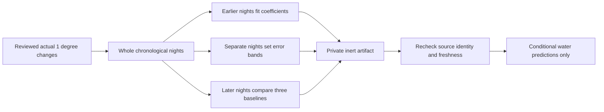

# Conditional water response research

This extends the [reviewed-response audit](TARGET_RESPONSE_EVIDENCE.md) with a
local, inert model and authenticated research APIs. It does not select a target,
run a comfort experiment or enable predictive control. The current target and
wake routine remain with the existing controller.

## Fixed evaluation policy

`target-response-ridge-v1` uses six coefficients with fixed physical scaling and
ridge regularization of 0.1. Inputs are preceding water temperature and trend,
previous and requested target, room temperature and humidity. Future values appear
only as observed 15- and 30-minute outcomes. Every night has equal total fitting
and evaluation weight, regardless of how many changes it contains.

At least 20 distinct reviewed nights are needed. About the latest quarter (at
least five nights) tests the fit, the preceding group of the same size sets
empirical error bands, and at least ten earlier nights fit it. At 21 nights,
the groups are 11/5/5 so adding a night cannot leave too few fitting nights.
Coefficients and support references are
never refitted on calibration or test nights. A valid result requires:

- At least 90% supported test observations, with the same target direction and
  preceding target represented by at least three distinct training nights.
- At least 80% observed coverage by the empirical error band.
- Mean absolute water error at least 10% and 0.1°F better than **each** of holding
  the last water reading, a fitted simple target-response coefficient, and
  extrapolating the preceding five-minute water trend.

Both horizons must pass. These are fixed project research gates, not established
clinical thresholds. A model that does not beat a simpler baseline is retained as
an unsuccessful evaluation, with predictions withheld. Calibration bands are
empirical errors; they are not causal or medical confidence intervals.

Windows, identities, canonical dates, acknowledgment clocks, preceding input
clocks, outcome horizons and nonoverlapping night splits are revalidated before
fitting. Twenty records from one night never substitute for twenty nights.

## Storage, freshness and privacy

The new `target_response_models` SQLite table contains an immutable model and its
source references. Fitting is explicit and checks the caller's dataset digest
again inside the durable save transaction. The registry keeps the latest three
artifacts per physical side, each bounded to 8 MiB; source records and the separate
unchanged-target forecast registry are not deleted by this retention policy.

Artifact identity includes the model and reference measurements. Source-reference
hashes bind reviewed nights, command receipts and actual water observations.
Changed or withdrawn references, incomplete reads, a changed configuration,
future clocks or expired evidence withdraw predictions. Adding a new night
preserves an unchanged older model; a new fit still requires the new dataset
identity. No model is selected from older artifacts because its score looks best.

Models and observations remain on the Pod. The APIs expose evaluation summaries,
not coefficients or raw reference windows. The existing owner authentication and
private/no-store responses apply. Personal-account API permissions are not widened.
Demo data cannot train a model or claim a real prediction.

## Interfaces and live observation guards

- `GET /api/v1/comfort/response/model?side=left` inspects collection and a saved fit.
- `POST /api/v1/comfort/response/train` requires `side` and `expectedDatasetHash`.
- `GET /api/v1/comfort/response/preview?side=left` compares at most two 1°F neighbors
  of the current reported target, within the hardware's documented target range.

Preview accepts no caller-supplied temperature, history or target. It uses the
same fresh, occupied, quiet, pre-alarm observation and real five-minute predecessor
as the existing unchanged-target forecast. Source configuration must match; the
current water observation must be at most 90 seconds old. Both candidate targets
share one bounded evidence read. Unsupported directions or conditions produce no
prediction. No candidate is selected and no hardware command is dispatched.

The status endpoint includes its evidence audit from the same bounded read, so
the screen does not repeat an expensive audit to show collection and model state.
The audit's legacy `modelAvailable: false` field describes its evidence-only
response; saved-model availability belongs to the separate model-status endpoint.
The web screen requests this combined status explicitly. Fitting requires its
current dataset identity, and predictions require a separate explicit read.
Error, expiry, partial evidence, another side or a failed evaluation withdraws
the corresponding action or prediction. Temperature units follow the saved
preference, including correctly converted error differences.

## Interpretation and acceptance

An observed response under the existing controller is conditional evidence.
It does not identify the causal effect of deliberately changing the bed, measure
body temperature, prove a sleep stage, or demonstrate improved comfort. Fixed
scales and night separation prevent direct data leakage; they do not remove
confounding, selective observation or selection bias from repeated model tuning.
The evaluation approach follows [chronological/grouped validation guidance](https://scikit-learn.org/stable/modules/cross_validation.html);
prospective experiments still need a defined objective and design, as described
in [NIST's experimental-design guidance](https://www.itl.nist.gov/div898/handbook/pri/section3/pri31.htm).

Synthetic fixtures validate the implementation, including rejection of weak
improvements and invalid evidence. They do not establish accuracy on Luca's Pod.
The final local validation passed 125 focused unit tests across nine files, a
production build and six authenticated browser flows. Additional unchanged response-
window and forecast suites were included in the earlier 154-test pass. The
21-night split failure was reproduced, corrected and retained with the passing
20/21/22/25/90-night regressions. Independent review of 23 captured states found
two presentation issues; the corrected copy placement and enlarged target labels
passed the focused verdict. Browser checks include 390px dark and 1440px light
layouts with 150% text, credential rejection and unchanged controller state.
Hosted checks, native parity and actual recorded-data receipts remain separate. A predictive controller still needs prospective Preview,
reviewed outcomes and the existing physical qualification/activation gates.
