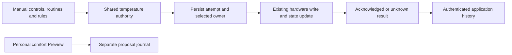

# Temperature application evidence

The shared temperature authority now records each attempted target write in
SQLite before calling the hardware client. This is separate from a policy
proposal, the arbitration winner, firmware status and physical observations.
Off and Preview still do not submit personal-comfort leases. Active remains
unavailable; this journal alone does not unlock it.

## Interpretation

- `attempting`: an attempt was saved, but no final result was durably recorded.
  It may still be in flight or may have been interrupted. Never display it as
  proof that a command is currently running or succeeded.
- `acknowledged`: the existing hardware client call and its state update
  completed, and that result was saved. This is **accepted, not physically
  verified**. It does not prove the achieved cover temperature or sleep benefit.
- `unknown`: dispatch, its state update or final receipt could not be confirmed.
  A command may have partly or fully reached the firmware. The record does not
  authorize a retry.

`targetF` and nullable `durationSec` describe the requested write. They are not
sensor readings. `source` and `requestId` identify the selected owner immediately
before the call, after transport recovery has rechecked arbitration. An
unselected proposal creates no receipt. A fallback power-on or unowned keepalive
has null source and request ID. `reason` distinguishes `manual`, `power_on`,
`reconcile` and `keepalive`.
This covers the shared controller's target-write paths. It is not a complete DAC
traffic log: power-off, raw diagnostic passthrough, pump-stall recovery outside
the shared apply path, base movement and vibration are outside this journal.

Each actual attempt has a separate UUID; this is an audit record, **not an
idempotency key**. Existing manual, schedule and keepalive behavior is retained.
The journal never starts or replays requests. MQTT and conditional controls keep
their separate request-level deduplication contracts.

If the initial durable write fails, the temperature command is withheld. Power
off does not depend on this journal and remains available. If the hardware call
succeeds but recording its result fails, the attempt remains unconfirmed; the
controller keeps the successful manual hold and its in-memory target, avoiding
an extra command caused solely by that audit failure. A clock reversal likewise
cannot manufacture an acknowledgment. A hardware or state-update error preserves
the existing error behavior and records uncertainty when storage permits.

## Owner API

`GET /api/v1/device/temperature/applications?side=left` and tRPC
`device.temperatureApplications` use the normal owner authentication. Side is
required. Pass optional `beforeId` from `nextBeforeId` to page older records.
Reads do not start the controller or hardware.
Capabilities advertise optional `endpoints.temperatureApplications` and
`features.temperatureApplicationHistory`. Older servers may omit these fields;
clients must then treat the history as unavailable. This does not change the
separate `controlSemantics.receiptScope` for deduplicated versioned controls.

The response has `apiVersion: 1`, `generatedAt` (epoch milliseconds), `side`,
`items` and nullable `nextBeforeId`. Each item includes monotonically ordered
`id`, UUID `attemptId`, `attemptedAt`, nullable `finishedAt`, `outcome`,
`acknowledgment` (`accepted_not_physically_verified` or `unconfirmed`), `reason`,
`source`, `requestId`, `targetF` and `durationSec`. Times are milliseconds, while
the explicitly named duration is seconds. Pages hold at most fifty records.
Missing credentials return 401; invalid side/cursor returns 400; unavailable or
malformed storage fails rather than masquerading as an empty history.

Migration **0043** adds the journal. Retention is thirty days and at most 10,000
records per side, pruned transactionally before admitting a new attempt. Reads
exclude aged records even during idle periods. No earlier commands are backfilled.
Rollback to an earlier binary uses its matching consistent database backup.

## Remaining work and validation boundary

This revision provides command evidence, with migrated SQLite, interruption,
storage-failure, arbitration, side-isolation, pagination and authenticated API
tests using synthetic data and mocked hardware. It is not a live Pod test.
The physical installation remains on Free Sleep.

The [personal execution adapter](COMFORT_APPLICATION_ADAPTER.md) now implements
guarded policy dispatch, durable correction cursors and conservative handling of
uncertain attempts. It is not constructed by production until the separate
owner activation, qualification and reviewed-night admission service is complete.
No Preview night or physical qualification is claimed. The web and native visual
designs are unchanged; clients can adopt this optional read-only history without
changing existing controls. Internally, the recorder also returns its result so
the adapter can distinguish a durable acknowledgment from a failed receipt save.
