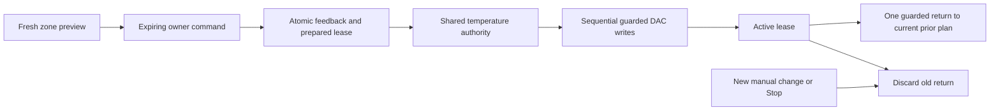

# Temporary cooling

The Tonight action “I’m too hot” reviews a request for one physical zone: up to
2°F cooler for at most 20 minutes, with an immediate cancel action. The hardware
floor is 55°F. The change never extends the existing firmware countdown and ends
before the known wake-warming span. It does not modify the saved alarm or schedule.

## Contract and behavior

- Owner-authenticated `GET /api/device/cooling?side=left|right` returns a timestamped
  proposal or the current lease. The additive `temporaryCooling` capability indicates
  implementation; the preview determines whether the hardware is currently usable.
- Commands use the existing durable receipts endpoint. `cooling.start` requires the
  physical side, a new cooling UUID, expected arrangement scope, expected current
  target, and reviewed latest end time. `cooling.cancel` requires the side and exact
  lease UUID. Neither action is added to the MQTT actuator allowlist.
- Start requires a fresh monitored powered zone, known firmware duration, water OK,
  no priming, no pump block, and a known wake context. It rechecks at the side lock
  and at each real FIFO write. At least one useful minute must remain.
- The prepared lease and explicit warm feedback are committed before any write.
  `comfort_moments` records feedback about a physical zone, not a person's identity,
  a measured temperature response or a training outcome. Morning feedback is separate.
- Existing manual holds retain their original expiry underneath cooling. The current
  prior plan is resolved at return time; a newer manual change, Stop, Resume or
  arrangement supersedes the lease. Independently reported target changes also
  withdraw its return.
- Start and return are each attempted once. Prepared, returning and unknown records
  are never replayed on reconnect or restart. A five-minute return grace requires
  fresh evidence; beyond it, an uncertain request yields to independently configured
  routines. Stale evidence cannot indefinitely suspend a saved wake span.
- The original manual-control pause applies to personal adaptation. Normal plans
  remain independently owned. The app does not claim the person felt cooler.

## Recovery and deployment

Generated configuration migration `0057_temporary_cooling` adds the lease and moment
tables. Back up configuration and biometrics with the normal migration/restore
procedure before deployment. Only the Pod authority operates the hardware; neither
the app nor a background mobile timer controls the return. Loss of the entire Pod
controller can delay return, so the app exposes an unconfirmed state instead of
claiming a hard real-time guarantee.

The new source has local policy, persistence, context, UI and authenticated browser
coverage, including target replacement, time rollback, stale/future data, wake
priority, cancellation, expired/deduplicated commands and lost replies. This is
software evidence. No physical thermal response, live wake delivery or deployment
is established by those tests.
