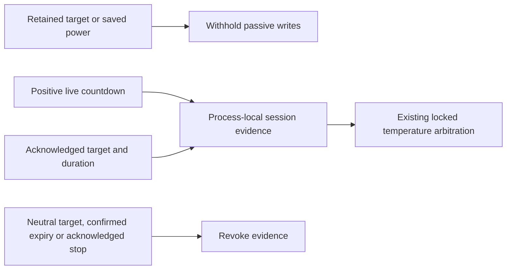

# Passive control requires a current heat session

The first bounded Pod 4 migration trial on 2026-10-25 reached authenticated
Core status and live NATS frames, then restored Free Sleep. The subsequent
firmware check found that the left side had started an eight-hour session.
It was explicitly returned to its pre-trial off state and verified off. That
trial is **not accepted as a successful operational migration**.

Free Sleep had stopped the countdown while firmware retained a non-neutral
target. Core's status mirror inferred power from that target. Once the first
status arrived, passive temperature arbitration selected the recurring target
and wrote a new duration. A fresh report alone was therefore insufficient.

The production controller now requires both a synchronized firmware report and
per-side heating-session evidence before passive reconciliation can write.
Evidence is shared across server chunks but is not persisted across a restart.
Pump RPM/duty and retained targets cannot establish it. Explicit manual and
scheduled power-on operations remain available through the existing authority.
Fresh command protection prevents delayed status from undoing a new command.

On firmware that always reports a zero countdown, passive control waits for an
explicit successful temperature/duration command after restart. It does not
guess that an old target is still active. The raw target remains available for
diagnostics; it is not proof of physical heating. Pump-stall protection keeps
its separate evidence and behavior.

Regression coverage includes fresh-but-ambiguous startup, per-side isolation,
passive loop/Autopilot/Resume, explicit manual control, positive countdown and
expiry, delayed polls, failed duration writes, and partial shutdown failure.
These software checks must be followed by another bounded Pod trial, including
firmware power/countdown comparison before and after restoring Free Sleep.
