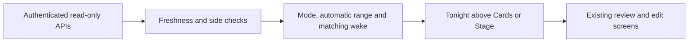

# Tonight

Approved improvement 03 brings the existing bed controls and the actual saved
plan together. The navigation label is Tonight; the route and actuator contracts
are unchanged. Both Cards and Stage keep temperature, notices, All off and the
advanced editors. Comfort-limit editing and recording checks remain available
under one disclosure.

## What the summary means

- Personal Autopilot shows Off, Preview, Active, a manual pause or an unavailable
  state. Training a model does not change this label to Active. An active label
  requires current activation, runtime and fault evidence.
- The automatic range comes from the same authenticated comfort-limit API used
  by arbitration. A manual hold can override it; this is explained in plan details.
- Next wake names the actual future occurrence and vibration duration. Warming
  time is shown only when the alarm and comfort-limit reads agree on occurrence,
  target and timezone. There is no hard-coded 30-minute assumption.
- Independently failed, expired, wrong-side or future-dated reads are withdrawn.
  Refresh never changes schedules or temperature. Successful network reads are
  not evidence that warming or vibration physically happened.
- Plan selection follows the sole schedule owner when appropriate. Independent
  zones keep separate plans even when there is only one sleep profile. Morning
  sleep context continues to follow the sleeper, not the temperature inspector.
- Between 04:00 and 13:00 in the Pod timezone, a morning entry leads to the latest
  whole-night record and comfort review. The actual record date is shown. Private
  Health-derived reports remain on the iPhone.

## Verification

Local acceptance on 10 November 2026: 221 focused Vitest tests plus 21 navigation
tests and ten isolated Playwright checks passed; production build, typecheck and
targeted lint passed.
Rendered phone and desktop layouts were reviewed in both Cards and Stage.

Unit coverage includes source expiry, independent failures, side changes,
activation/manual pause, DST morning boundaries and coherent wake occurrences.
Existing temperature and Stage tests exercise the unchanged control paths.
Browser checks use isolated fixture databases, disabled service workers and
mobile/desktop viewports; they exercise both layouts, failed reads and wake-plan
side navigation. Navigation regressions also cover 305px/320px viewports with
200% text, fixed accessible tabs and reachable scrolling bed controls. The
enlarged-text check found and verified a fix for the plan heading overflowing a
narrow screen. Read-only browsing is asserted to send no POST mutations.

The Stage's keyboard shortcuts ignore other interactive controls so opening a
plan link cannot also power or adjust the bed. Room readouts and toolbars were
checked in rendered mobile/desktop captures. Native acceptance is tracked in
`sleepypod-ios/Integration/parity/TONIGHT_OVERVIEW.md`.

These are source, fixture and simulator checks. Pod deployment, physical behavior
and TestFlight delivery require their own release receipts. Personal adaptation
and wake routines have not been enabled or changed by this UI work.
