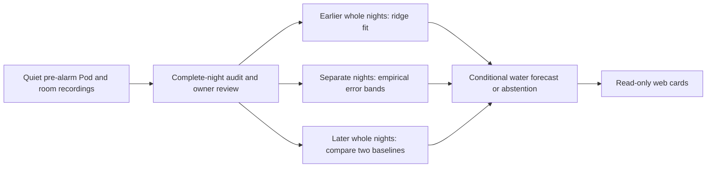

# Water response forecasting

`water-response-ridge-v1` is a local, fitted model of the **reported water
temperature** 15 and 30 minutes ahead, conditional on an unchanged target and
similar room conditions. It runs in TypeScript on the Pod. It is a research
component for a future controller, not a body-temperature estimate, sleep-stage
model or command to change the bed. No cloud API or API key is involved.

## Why this component exists

The morning comfort model predicts a warm/cold direction from nightly medians.
That does not describe how the water responds over minutes, or prove that a
particular adjustment improves sleep. These are different learning problems.

[Eight Sleep describes Autopilot](https://www.eightsleep.com/autopilot/) as using
personal preferences, activity, stages and room conditions for adjustments. Its
published product description supplies neither transferable weights nor a
validated control law for our software.

The [2025 sleeping thermoregulation study](https://doi.org/10.1016/j.buildenv.2025.112882)
models skin temperature using physiological and bedding parameters and evaluates
ten participants under controlled conditions. Our water sensor does not provide
those inputs. The [sleep comfort model published online in 2025, volume 2026](https://doi.org/10.1016/j.enbenv.2025.07.003)
separately models thermal sensation and discusses bedding microclimates. Neither
paper validates this Pod forecast. They support keeping water response, body
temperature and perceived comfort distinct. Our regression, sample thresholds and
error gates below are explicit engineering choices, not results from those papers.

## Data and timing contract

The existing complete-night audit remains the entry point:

- A morning check-in plus a current actual-night review bound to source hashes.
- Production recordings from the same side, hardware, calibration, routine and
  room configuration; fresh occupied measurements without manual pauses or motion.
- A 6–12 hour window, at least six actual recorded hours, at least 90% thermal
  coverage, no interior gap over ten minutes or edge gap over 30 minutes.
- The pre-alarm window excludes wake warming. Temperature targets spanning more
  than 2°F across the night are excluded by the shared comfort-data audit.

The forecast does not use the check-in's warm/cold label, but deliberately shares
that reviewed-night cohort in this version. Historical Health totals without
paired thermal observations cannot substitute for recordings. Complete short
nights currently abstain rather than being padded to meet these filters.

For each whole night, the model uses actual observations about five minutes
apart, with 30 seconds of cadence tolerance. Each forecast origin needs an actual
five-minute predecessor. Origins are at least 15 minutes apart. Labels are
observed water changes 15 or 30 minutes later, within 45 seconds. A window is
excluded if any intervening target changes, a sample is missing, room temperature
changes more than 2°F, or humidity changes more than ten percentage points. Each
night needs twelve eligible origins at both horizons. These future conditions
select the conditional evaluation domain; they are never input features.

At prediction time the only features are:

1. An intercept.
2. Current target minus water temperature, divided by 5°F.
3. Current room minus water temperature, divided by 10°F.
4. The actual preceding five-minute water change, divided by 2°F.
5. Current relative humidity minus 50%, divided by 20 percentage points.

These fixed scales are not fitted to future observations. Each horizon has five
ridge-regression coefficients and predicts water change directly. It does not
roll predictions forward as if they were measured observations. Each night has
equal total fitting weight. Regularization is 0.01 except for the intercept.

## Whole-night evaluation and abstention

Require 20–90 distinct complete nights. Reserve the newest quarter (minimum five)
for final evaluation, and the preceding quarter (minimum five) for error-band
calibration. Only earlier nights fit coefficients, the simple-response baseline
and supported conditions. At the minimum this is 10 fitting, 5 calibration and
5 evaluation nights. No epochs from one night cross these partitions.

Compare both horizons with persistence (hold the latest water reading) and a
one-parameter first-order response toward the current target, fitted only on the
training nights. Error bands use the 90th percentile of each calibration night's
90th-percentile absolute error, with a 0.25°F minimum. They are empirical error
bands, not a guarantee of 90% coverage or medical confidence intervals.

Both horizons must independently meet all these prespecified gates on later nights:

- At least 90% of conditions supported by three distinct fitting nights.
- At least 80% of observed outcomes inside the empirical error bands.
- Night-equal mean absolute error at least 10% and 0.1°F below the better baseline.

The current target must be within 0.25°F of observed fitting targets, and scaled
feature distance must be at most 1.5 for at least three distinct fitting nights.
This prevents unsupported target extrapolation. In particular, fitting at 70°F
does not authorize predicting the effect of an unobserved 105°F wake target.
Any failed horizon, invalid input, changed source/configuration, clock rollback,
reference older than 45 days, or predicted error band outside 50–115°F withholds
both forecasts. New nights alone do not invalidate unchanged source references.
Edited or deleted reference data does invalidate them.

These thresholds are conservative software gates, not a powered clinical trial.
Repeated tuning against the same holdout would bias results; a new model design
must reserve genuinely unseen evaluation nights. The model does not establish
the causal effect of changing a target, even after passing its forecast gates.

## API, persistence and interface

All endpoints retain the controller's owner authentication:

- `GET /api/v1/comfort/forecast?side=left`: reviewed-night readiness, exclusions,
  source identity and saved evaluation. Coefficients and support rows remain local.
- `POST /api/v1/comfort/forecast/train`: explicit fit with the expected dataset
  hash; stale inputs return conflict, insufficient nights return precondition failed.
- `GET /api/v1/comfort/forecast/preview?side=left`: conditional forecast using fresh
  guarded current readings and an actual matching preceding observation.

Artifacts, per-night proofs and integrity hashes are stored in `thermal_forecasts`
in the controller database. Fitting checks the dataset again before durable save.
Readiness and inference never write a control request, change a mode or start
training. Duplicate fitting of unchanged data reuses the existing artifact.

The web Autopilot page presents “How your bed responds,” with separate readiness,
water predictions, empirical error bands and baseline comparisons. An empty
dataset is shown as collecting, with training disabled. Native build 18's model
inventory covers stage estimation and private night anomaly analysis; this new
water forecast card is a separate web addition, not present in that native build.

## Verification boundary

Software tests include preceding-only features, whole-night leakage checks,
fragments and gaps, unsupported targets, failed comparisons, source edits, clock
changes, persistence, authentication and the real SQLite audit-to-fit path.
Synthetic heat-equation fixtures exercise those paths and are never installed as
personal model weights. Passing these checks does not establish accuracy on the
owner's bed, improved sleep, or authorization for autonomous adjustment. Those
require actual qualified recordings and separately reviewed prospective trials.
