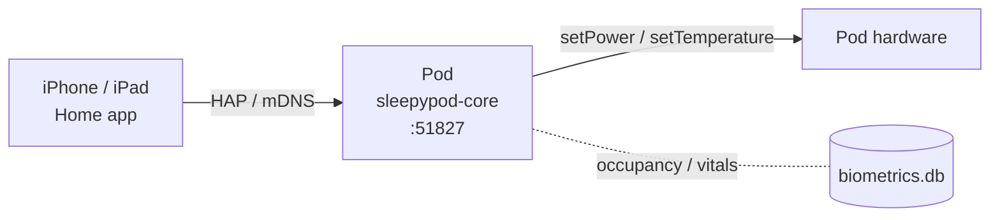
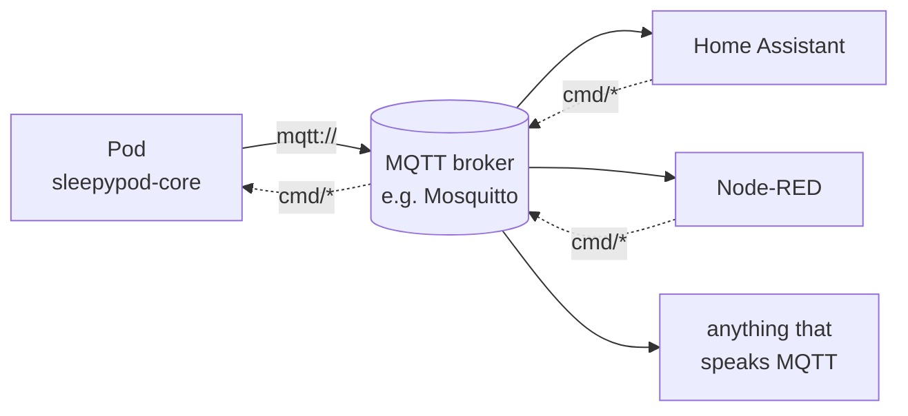

# HomeKit and MQTT reference

Setup steps live in the user guide: **[HomeKit and MQTT](https://sleepypod.github.io/core/integrations/)**. This page keeps the protocol-level reference that changes with the code: accessory mappings, identity, topics, and environment variables.

---

## HomeKit bridge

The Pod ships an embedded [hap-nodejs](https://github.com/homebridge/HAP-NodeJS)
bridge that publishes itself as a native HomeKit accessory over Bonjour. No
Homebridge install, no Apple cloud round-trip — pairing and control happen
entirely on your LAN.

The bridge is **off by default** — toggle it on from **Settings → HomeKit**.
The installer's iptables rules accept HAP (tcp/51827) only from LAN address
ranges; mDNS discovery (udp/5353) is accepted without a source restriction,
so the bridge is discoverable but not pairable or controllable from outside
the LAN.

### Accessories

Each side (`left`, `right`) gets its own set; switches that act on the whole
pod ship once.

| Accessory | Type | Reads from | Writes to |
|---|---|---|---|
| `Bed <side>` | Thermostat (single setpoint) | Fresh reported DAC state; explicit staged target while off | Shared temperature/power controller |
| `Bed <side> occupancy` | OccupancySensor | Fresh calibrated capacitance and movement | — |
| `Snooze <side>` | Switch | `snoozeManager` | `snoozeAlarm` / `cancelSnooze` |
| `Prime` | Switch | `primeNotification` (auto-off on completion) | `startPriming` |
| `Pod ambient` | TemperatureSensor | Live `bedTemp` / `bedTemp2` ambient cache | — |

Thermostat is HomeKit's single-setpoint primitive (the pod hardware exposes
one setpoint, not a heat/cool deadband). Mode `off` cuts power; `auto` powers
on at the last requested temperature. HomeKit Celsius is converted at the
boundary; the in-app unit preference is unaffected. Missing or stale reports
return HAP unavailable, with a fault combined with any pump-stall notice.
See [reported-state semantics and qualification limits](HOMEKIT_REPORTED_STATE.md).

### Identity durability

The bridge's HomeKit identity (MAC-style username, pincode, setupId) is
**deterministically derived** from a hardware-rooted seed (eMMC CID →
machine-id → random fallback) via HKDF, and cached at
`$DATA_DIR/homekit/identity.json` (where `$DATA_DIR` is the picker-chosen
data dir — see [`scripts/README.md`](../scripts/README.md#file-locations);
typically `/persistent/sleepypod-data/homekit/identity.json` on Pod 4/5).
As long as the selected seed is unchanged, a `/persistent` wipe or
firmware reflash regenerates the **same** identity, so iOS still recognizes
the bridge — you only re-pair, your automations and rooms stay intact. When
the seed comes from `machine-id` (which does not survive a factory reset) or
the `random-dev` fallback, deleting `identity.json` produces a new identity,
and the bridge must be removed and re-added in iOS. See
**[ADR 0020](adr/0020-homekit-identity-derivation.md)** for the full
rationale, seed chain, and what the design intentionally does *not* protect
against.

### Environment variables

Headless deployments can override the auto-detected mDNS advertiser. All
other config (enable/disable, pairing) lives in `device_settings` and is
managed from the UI.

| Variable | Default | Description |
|---|---|---|
| `HOMEKIT_ADVERTISER` | auto (`avahi` if `/run/avahi-daemon/socket` exists, else `ciao`) | mDNS advertiser; force `avahi` to coexist with the existing `_sleepypod._tcp` service file, or `ciao` for pods without avahi |

---

## MQTT bridge

The Pod can connect outbound to an MQTT broker you already run (typically the
[Mosquitto add-on](https://github.com/home-assistant/addons/tree/master/mosquitto)
that ships with Home Assistant). Off by default — opt in from
**Settings → MQTT** in the web UI.

The Pod is a **client**, not a broker. It does not embed a broker, does not
listen on 1883, and does not punch holes in the LAN-only iptables policy.

### Configuration

Headless deployments can skip the UI by setting environment variables;
the bridge resolves config in this order: `device_settings` row > env var > built-in default.

| UI field | Env var | Default |
|---|---|---|
| Enable bridge | `MQTT_ENABLED` | `false` |
| Accept commands (host configuration only) | `MQTT_COMMANDS_ENABLED` | `false` |
| Broker URL | `MQTT_URL` | _(unset — bridge stays dormant)_ |
| Username | `MQTT_USERNAME` | _(none)_ |
| Password | `MQTT_PASSWORD` | _(none)_ |
| Topic prefix | `MQTT_TOPIC_PREFIX` | `sleepypod` |
| HA discovery | `MQTT_HA_DISCOVERY` | `true` |
| HA discovery prefix | `MQTT_HA_DISCOVERY_PREFIX` | `homeassistant` |
| Require TLS | `MQTT_TLS` | `false` |
| TLS allow self-signed | `MQTT_TLS_INSECURE` | `false` |

The URL scheme selects the transport: `mqtts://` and `wss://` are encrypted;
`mqtt://` and `ws://` are plaintext. **Require TLS** rejects plaintext URLs
before opening a connection. It does not change the URL or port. Enter the
broker's actual secure endpoint when enabling this requirement. A secure URL
still uses TLS when the requirement is off. Unsupported schemes are rejected.

Enabled settings updates validate the fully resolved configuration, including
inherited database/environment fields. Disabling an invalid configuration remains
possible. If the settings database cannot be read, startup and connection tests
stop rather than falling back to an unknown transport policy.

Certificate verification stays enabled unless both Require TLS and the separate
host-only `MQTT_TLS_INSECURE` override are on. That override permits unverified
certificates; it is not exposed as an ordinary settings toggle.

Saving a blank password preserves the saved password. **Test connection** uses
only a password entered for that test; it never silently sends the saved password
to a proposed broker. Re-enter it to test authenticated access. Editing the
endpoint, TLS requirement or credentials clears the previous test result.

### Topics

`<prefix>` defaults to `sleepypod`. `<device-id>` is the slugified hostname
(override with `MQTT_DEVICE_ID`). Discovery and connection availability are retained; measurements and execution receipts are not.
See [qualified home telemetry](HOME_TELEMETRY.md) for source timestamps, expiry, null fields and migration.

| Topic | Direction | Payload |
|---|---|---|
| `<prefix>/<device-id>/availability` | pod → broker | `online` / `offline` (LWT) |
| `<prefix>/<device-id>/state/device-status` | pod → broker | fresh reported DAC status; no optimistic overlay |
| `<prefix>/<device-id>/state/<side>/climate` | pod → broker | per-side temp / mode |
| `<prefix>/<device-id>/state/water-level` | pod → broker | `low` / `ok` / `unknown` |
| `<prefix>/<device-id>/state/biometrics/<side>` | pod → broker | qualified live HR / beat-interval variability / BR |
| `<prefix>/<device-id>/state/environment/ambient` | pod → broker | `{"ts": <epoch_ms>, "temperature": <number\|null>, "humidity": <number\|null>}` (°C, %) |
| `<prefix>/<device-id>/state/occupancy/<side>` | pod → broker | calibrated occupied / classification, or unavailable |
| `<prefix>/<device-id>/cmd/request` | broker → pod | Expiring control request; explicit opt-in required |
| `<prefix>/<device-id>/receipt/<request-id>` | pod → broker | Non-retained execution receipt; physical effect unverified |

Enabling the bridge now enables telemetry only. Command reception separately
requires `MQTT_COMMANDS_ENABLED=true`, dedicated broker credentials and topic
ACLs. The old raw actuator topics are no longer supported. Commands reuse the
app's durable control authority, deadlines and hardware guards; they cannot
invoke priming or base movement through MQTT.

See [MQTT command delivery](MQTT_COMMANDS.md) for the full envelope, Home
Assistant discovery behavior, receipt lookup, migration and validation limits.
The original [ADR 0019](adr/0019-mqtt-bridge.md) describes the earlier design.
