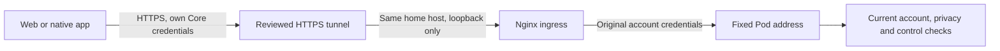

# Core remote ingress

This is an **inactive, locally tested deployment component**, not a published
remote connection. It renders an Nginx listener on the home host's loopback
interface. A separately configured HTTPS tunnel connects to that listener; no
router port forwarding or device VPN is required by this design. Publishing and
cellular/work-network testing remain deployment tasks.



## Authentication and scope

Core authenticates requests. The ingress passes the client's bearer credential,
separate browser cookies, browser-account scope and fresh connection challenges
unchanged. It never stores or substitutes an owner key. This is intentionally
different from the older Free Sleep gateway, which used one fixed owner token
and the older REST route list.

Supported remote operations include authenticated reading, ordinary temperature
and alarm controls, temporary controls through Core's receipt API, owner routines,
overnight comfort limits, personal sessions/preferences/routines, journal entries,
quiet requests and Stop. Core's current role, freshness, revision, qualification
and expiry checks still apply. Reading presence does not prove who is present.

Writes use an explicit method/path list. Unknown writes fail closed. Priming,
general-purpose commands, maintenance, arrangement activation and raw data/MCP
surfaces remain local. Sensor WebSockets are not provided by this component;
ordinary native controls use HTTPS independently. Cloud model training, some
advanced settings and any write absent from the list also require the local app.
The ingress is therefore not a claim of complete remote feature parity.

## Prepare without changing a live system

On the intended home connector, use a verified Pod address and a hostname you
control. The example hostname below is not a deployment address:

```sh
python3 scripts/remote_ingress/render.py \
  --public-host sleep.example.com \
  --pod-address 10.0.1.69 \
  --output /path/to/new/sleepypod-ingress
```

The output must be a new directory. The generator accepts only a DNS hostname,
an explicit private IPv4 Pod address and unprivileged ports; it does not accept
credentials. `deployment.json` records `published: false` and `started: false`.
It does not alter Pod services, Homebridge, Home Assistant, Tailscale or routines.

With Nginx installed, validate the rendered file using its absolute paths:

```sh
nginx -p /path/to/new/sleepypod-ingress/ \
  -c /path/to/new/sleepypod-ingress/nginx.conf -t
```

Only after reviewing the host configuration, start the dedicated proxy using
the same prefix/config with `-g 'daemon off;'`, under a normal supervised user
account. Do not replace the machine's unrelated Nginx configuration. Keep the
listener on `127.0.0.1`; this HTTP listener is not an internet-facing server.

## HTTPS connector and first live acceptance

Cloudflare Tunnel is one possible connector. Configure exactly the reviewed
hostname to `http://127.0.0.1:18080` on the same home host, retaining that hostname
in the forwarded Host header. Use its final unmatched-host 404 rule. Configure
cache bypass for the entire hostname; the ingress and Core also send `no-store`.
Keep the tunnel's own credentials separate from every Core account key.

This route uses **Core application authentication**. Cloudflare Access is a
separate authentication layer: its default browser redirects cannot be completed
by the current native HTTP client. If Access is required, implement and test its
native login flow before publishing; do not claim Safari success verifies iOS.
Do not weaken an employer's VPN or device policies to make the connection work.

Before publishing, verify the actual Core release refuses missing/incorrect
credentials on every private-data and control API and is configured with its
owner/personal authentication. Separately enumerate the intentionally public
sign-in/bootstrap responses and confirm they contain no private data or controls.
The local proxy tests use a synthetic origin; they prove
transport behavior, not the deployed controller's authorization configuration.

After publishing, verify the certificate, fresh owner and personal challenges,
account switching and revocation, no-store responses and an ordinary read on
cellular and the permitted work network. Then perform an attended ordinary
control/readback. An uncertain command must be inspected by receipt rather than
resent. Disconnect the connector separately and verify local Pod routines remain
independent. These observations are still outstanding.

The proxy makes no retry after a lost upstream response, limits request bodies,
does not cache API data or record access logs, and never follows an upstream
redirect itself. Core and tunnel/provider logs retain their own separate policies.

## Repeatable local tests

```sh
python3 scripts/remote_ingress/test_ingress.py -v
```

Nginx is required; its absence fails rather than silently skipping the checks.
The suite starts only a loopback synthetic origin and a task-owned Nginx process,
then shuts both down. It verifies individual bearer identities, browser cookies,
connection challenges, host/origin validation, explicit writes, blocked maintenance,
no caching, size limits and no replay after a lost command response. It never
contacts a Pod or publishes a hostname. GitHub runs the same suite on Linux.

Primary references:
- [Nginx proxy configuration](https://nginx.org/en/docs/http/ngx_http_proxy_module.html)
- [Cloudflare Tunnel configuration](https://developers.cloudflare.com/cloudflare-one/networks/connectors/cloudflare-tunnel/do-more-with-tunnels/local-management/configuration-file/)
- [Cloudflare Access for published applications](https://developers.cloudflare.com/cloudflare-one/access-controls/applications/http-apps/self-hosted-public-app/)
- [Native clients and Access authentication](https://developers.cloudflare.com/cloudflare-one/access-controls/applications/http-apps/managed-oauth/)
