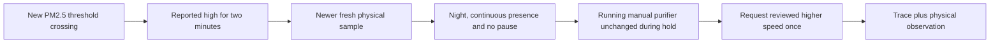

# Respond to bedroom particles

The [purifier blueprint](blueprints/bedroom_purifier.yaml) can raise one selected,
already-running purifier to a reviewed speed when a new PM2.5 threshold crossing
persists for two minutes. It complements the existing notification-only
air-quality review. Both the automation and its separate Allow input start off.

The default action window is 22:00–05:00 in Home Assistant's timezone. At least
one qualified, expiring Pod occupancy sensor must remain occupied from the start
of the excursion. This does not identify who is in bed. Optional existing pause
helpers, including Partner resting, must remain known off for that interval.

## What a request means

- The previous and crossing readings must be numeric PM2.5 measurements in
  `µg/m³`. Unknown/unavailable recovery and an already-high reading at startup
  cannot trigger a request. The HA numeric-state trigger supplies the two-minute
  hold and cancels it if the value leaves the range or becomes unavailable.
- The crossing needs a valid original measurement clock. Dispatch needs a **newer
  physical sample** above the threshold, inside its permitted age. Republished
  cache values, a future clock, or Home Assistant's receipt timestamps cannot
  substitute. The hold establishes continuous reported values, not continuous
  physical measurement or a medical conclusion.
- The request expires 30 seconds after the hold. There is no catch-up on reload,
  reconnection, entering the night window or getting into bed after an excursion.
  A new qualified crossing can produce a later request.
- The selected `fan` must report on, a numeric positive speed below the target,
  and `SET_SPEED` support. Groups exposing `entity_id`, assumed-state devices,
  active presets, missing values and off devices are skipped. HA has no general
  purifier-only fan class: the owner must verify the physical device identity.
- Any **reported fan state or attribute change** after the excursion began
  cancels this proposal, even if the speed is later returned to its old value.
  This deliberately includes changes that cannot be attributed to a person.
  Integrations that update a heartbeat attribute constantly may therefore
  withhold requests; qualification must establish actual behavior.
- Only `fan.set_percentage` is sent. The routine does not power on, power off,
  change presets, lower an existing higher speed, control a diffuser or change
  the Pod. There is no retry queue or automatic speed restoration. Use the
  purifier's normal controls to lower its speed afterward.

Home Assistant traces retain the evaluated source times, readings and requested
speed. Service acceptance is not proof of airflow or improved air quality. A
manual command can still race the final network request; reported-state checks
cannot make a physical accessory transaction atomic.

## Your saved accessories

The saved House Control inventory identifies a **Govee H712C** purifier with
Homebridge `RotationSpeed` values 0/33/66/99 and a **Govee H5106** air-quality
monitor. Those are inventory observations, not a verified HA integration.
Home Assistant may map discrete speeds differently: select and test the actual
HA percentage rather than copying raw Homebridge values. Percentages describe
speed settings, not measured airflow.

The H5106 bridge's cached value does not currently establish a fresh physical
measurement. Its zero/unknown values must not be advertised as clean air. Until
a supported integration supplies a verified measurement timestamp and valid
reading, keep this action disabled and use the existing review surface. Do not
invent a timestamp with `now()`, `last_updated` or a polling receipt.

The **H7161 Aroma Diffuser Pro** is power-only through the saved bridge. It is
not this purifier and has no qualified humidity setpoint. This blueprint does
not operate it or change any Apple Home/Homebridge pairing.

## Install and qualify

1. Import the blueprint from a reviewed commit using Home Assistant's Blueprint
   import page. Choose the individual purifier, PM2.5 sensor and source-time
   attribute, plus qualified Pod occupancy sensors. Leave Allow off.
2. Verify actual sensor measurements and timestamp behavior, including repeated
   unchanged values and loss of the source. The 15 µg/m³ default is an editable
   example, not a clinical threshold or a recommendation for your room.
3. While nearby, use the normal purifier control to verify its identity, speed
   mapping, state reporting, presets, manual changes and Stop/off behavior.
   Confirm it becomes unavailable if the integration loses contact.
4. Choose a comfortable response speed. For an attended routine test, enable
   Allow and the automation. Review a qualifying trace and physical response,
   then verify paused, stale, off-device and recent-manual-change cases.
   Do not create smoke or another pollutant to provoke the sensor. Synthetic
   source fixtures belong in the isolated test environment, not the live room.
5. Keep the automation disabled if a prerequisite cannot be established. After
   physical acceptance, persistent operation is a separate owner deployment
   choice: take control of the automation and remove `initial_state: false` to
   use HA's saved enabled state. By default, reload/restart disables it again.

The pinned HA schema/script-engine suite uses synthetic measurements and a stub
fan service. It covers crossing identity, holds, clocks, units, expiry, night
windows, pauses, occupancy, capabilities, presets, manual changes and failure
without replay. It does not establish live appliance compatibility.

Local validation passed **73 tests**, including **19 purifier scenarios**, using
the pinned Home Assistant 2026.10.4 runtime. Hosted checks, actual integration
mapping and attended physical observations remain separate evidence.

References: [Home Assistant fan actions](https://www.home-assistant.io/integrations/fan/),
[fan percentages and presets](https://developers.home-assistant.io/docs/core/entity/fan/),
[numeric-state triggers](https://www.home-assistant.io/docs/automation/trigger/#numeric-state-trigger).
