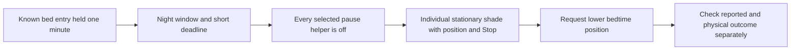

# Prepare the bedroom shades when someone gets into bed

This is the shade-positioning part of the bedroom routine. It uses existing Home
Assistant entities; it does not commission a Lutron project, discover integration
IDs, or change Homebridge and Apple Home pairings. The saved House Control
inventory records three Lutron blinds, but their individual integration IDs and
physical position/Stop behavior still need verification.

Between **22:00 and 05:00**, a known empty-to-occupied transition that remains
occupied for one minute can lower selected individual shades toward a chosen
position. The default is **0% open**, meaning fully closed in Home Assistant.
The selectable target is 0–50% open. A shade already at or below that position
is left alone. Entering bed before the window does not schedule a later catch-up.

## Selection and control behavior

- Select only individual `blind`, `shade` or `curtain` entities. Other cover
  classes, including windows, doors, gates, garages, shutters and awnings, are
  rejected inside the routine even if supplied outside the selector UI.
- Each entity must report a numeric position, support `SET_POSITION` and `STOP`,
  and currently report `open`. Moving, unavailable, closed and optimistic
  (`assumed_state: true`) entities are skipped. Missing position is not treated
  as fully open. Home Assistant groups exposing `entity_id` are skipped;
  integration-specific opaque groups must be excluded during qualification.
- Each request rechecks the same continuous occupancy interval, the night window,
  the selected pause helpers and the shade. Requests expire 30 seconds after the
  one-minute hold. There is no retry queue, delayed reopening or restoration.
- A helper such as **Partner resting** or **Pause shade routines** inhibits further
  commands whenever it is on, unknown or unavailable. The routine does not infer
  who is in bed, create a helper, or change a household arrangement.
- An existing shade movement is not interrupted. A pause or lost bed signal stops
  further dispatch, but **does not stop a shade that has already begun moving**.
  Use the accessory's own Stop control for that. A failed service call aborts
  the remaining requests instead of replaying them later.

The controller reads reported accessory state immediately before dispatch. A
manual change can still race a network request; these operations are not atomic
with the physical motor. Service acceptance, reported position and observed
movement are separate evidence. Supporting a Stop command does not prove that
Stop works on your particular shade.

## Set up and qualify

1. Import [the shade blueprint](blueprints/bedtime_shades.yaml) and create an
   automation. Leave **Allow bedtime shade positioning** off. The automation
   also starts disabled after every reload or Home Assistant restart.
2. Select the calibrated, expiring Core occupancy sensors and the actual
   individual bedroom shade entities. Do not substitute an unverified Lutron
   ID or remove an Apple Home pairing to obtain a matching name.
3. Test each shade using its normal Home Assistant control while nearby: verify
   identity, direction, current position, a small position change, and Stop.
   Confirm the entity becomes unavailable when its integration loses contact.
   Keep any shade that fails these checks out of the automation.
4. Choose the bedtime position and optional pause helpers. For the attended
   routine check, start with one shade and a nearby target, then enable Allow
   and the automation. Verify entry, an already-lower shade, a moving shade,
   unavailable occupancy and an active pause. Check the trace and actual motor
   behavior separately. Use the shade's Stop if needed.
5. Once accepted, add the remaining qualified shades. If choosing persistent
   operation, take control of the automation and remove `initial_state: false`
   through Home Assistant's own workflow. This is a deployment choice after
   qualification; installing or merging the blueprint never enables it.

The Pod remains the authority for its temperature, routines, alarm and base.
This template sends only `cover.set_cover_position` to selected shades and does
not change any Pod state or claim to implement snoring/base movement.

## Validation

The pinned Home Assistant 2026.10.4 tests load the real schemas and execute its
script engine. Captured services replace hardware. Cases cover directions and
capabilities, groups, missing data, pauses, manual movement between requests,
source replacement, dispatch expiry and service failure. They do not establish
live integration or physical qualification.

Local validation passed **54 Home Assistant tests**, including **16 shade
scenarios**, on the locked runtime. Hosted checks and real accessory tests are
separate release and deployment evidence.

References: [cover states and actions](https://www.home-assistant.io/integrations/cover/),
[position and supported features](https://developers.home-assistant.io/docs/core/entity/cover/),
[state-trigger hold behavior](https://www.home-assistant.io/docs/automation/trigger/#holding-a-state-or-attribute).
The existing accessory mapping was checked against `docs/accessory-controls.md`
in the local House Control repository; that saved inventory is not live validation.
