# HomePod climate reports through Apple Home

This exporter connects Apple Home's HomePod temperature/humidity readings to the
existing bedroom report contract. It does not use Apple's private APIs or remove
HomePod/Homebridge pairings. It is a reporting path, not a Pod controller.

```mermaid
flowchart LR
  Timer[HA minute timer] --> Helper[Dedicated virtual helper]
  Helper --> Bridge[Helper-only HomeKit Bridge]
  Bridge --> Shortcut[Apple Home automation]
  Shortcut -->|temperature and humidity| Webhook[Private local HA webhook]
  Webhook -->|cached observations only| MQTT[Fixed bedroom report topic]
  MQTT --> Pod[Authenticated Pod controller]
  Pod --> Clients[Web and native last-reported readings]
```



## Install the Home Assistant side

1. Keep the Pod's comfort policy Off/Preview. Connect the Pod to your private
   MQTT broker, with actuator commands disabled. Obtain its exact
   `mqtt.topic` and configuration `revision` from `GET /api/v1/home/bedroom`.
   Broker credentials belong in server configuration, never in the Apple
   automation. Restrict publisher access to the bedroom report topic.
2. Create an **Input boolean** helper named **Sleepypod HomePod Sample**.
   Expose only that entity through a dedicated HomeKit Bridge in **include**
   mode. Do not include entire physical accessory domains. Pair that bridge
   into the existing Apple Home using an iPhone/iPad; Mac Home cannot add an
   accessory. [Apple's pairing guidance](https://support.apple.com/guide/home/add-accessories-hmead877ec9c/mac),
   [Home Assistant bridge filters](https://www.home-assistant.io/integrations/homekit/#configure-filter).
3. Import `blueprints/sensor-export/apple_home_cache.yaml`. Create one
   automation per HomePod, with a distinct random private webhook ID of at
   least 32 characters. Enter the exact temperature/humidity source IDs,
   the temperature source's configured unit, the current revision, and the
   bedroom MQTT report topic. Leave **Enable sensor reporting** off until
   the Apple automation is ready. No Pod owner key is used here.
4. Import `blueprints/sensor-export/apple_home_poll.yaml`, select the dedicated
   helper and leave **Enable periodic requests** off during setup. When
   enabled, it pulses that virtual helper once per minute. Home Assistant
   preserves the automation's chosen on/off state across restarts.

Each blueprint uses Home Assistant's supported automation and MQTT actions.
The receiver accepts POST JSON through a `local_only` webhook, suppresses saved
traces, fixes its source IDs/topic/revision in configuration, and publishes
non-retained QoS 0 reports. The caller cannot choose a command, freshness class,
measurement clock, revision, or source ID. Keep webhook IDs private and do not
publish their URLs. [Webhook reference](https://www.home-assistant.io/docs/automation/trigger/#webhook-trigger),
[MQTT reference](https://www.home-assistant.io/integrations/mqtt/).

## Create one Apple Home automation per HomePod

Use the existing Home with those HomePods. Select **An Accessory Is Controlled**,
choose **Sleepypod HomePod Sample**, and trigger when it turns on, at any time.
At the accessory-action screen choose **Convert to Shortcut**.
[Apple's home automation instructions](https://support.apple.com/guide/shortcuts/create-a-new-home-automation-apd2a290f633/ios).

Read **Current Temperature** and **Current Relative Humidity** from the same
HomePod with **Get the State of Home**. Identify the two devices separately;
two generically named “Temperature Sensor” tiles are not sufficient to establish
which HomePod is which. Check the accessory details or give the sensor tiles
distinct names before selecting them. Do not average or substitute another
device's value in the shortcut.

Add **Get Contents of URL**, using that HomePod's private local webhook URL:
`http://<home-assistant-host>:<port>/api/webhook/<private-id>`.
Select **POST**, **JSON** request body, with these fields:

| Key | JSON type | Value |
| --- | --- | --- |
| `schemaVersion` | Number | `1` |
| `temperature` | Number | The temperature action's numeric output |
| `temperatureUnit` | Text | Exactly `°C` or `°F`, matching that action's output |
| `humidity` | Number | The humidity action's numeric output, from 0 to 100 |

If the temperature action returns a Measurement, explicitly convert it to the
chosen temperature unit and obtain its numeric magnitude. Verify the resulting
body with the real Home action; do not assume the phone's display unit or send
formatted text such as “73°F” as a number. A missing/failed sensor must not become
zero or a previously saved shortcut variable. Null/invalid readings are withdrawn;
unknown units or extra fields reject the envelope.

Enable the matching receiver, then test the Apple automation once. Check that
the Pod receives two **cached** reports with the correct IDs and sensible unit
conversion. Repeat for the second HomePod. Enable periodic requests only after
both paths are verified. No physical accessories are part of the helper pulse.

## Qualification and failure checks

- Compare each received value and unit with the corresponding Apple Home tile.
  Confirm all four sources update over several timer cycles in both clients.
- Stop the timer and disconnect a HomePod separately. Record how the Home app's
  sensor read behaves. If Apple returns a cached number, the report remains
  cached; an HTTP success does not prove a new physical measurement.
- Restart HA and the Pod, verify the bridge pairing persists, and check that
  old/retained messages are not promoted to live observations. Test with the
  phone away: the automation must run on the home hub without the Mac.
- After editing bedroom source configuration, update each export's revision.
  Old-revision reports are rejected; they cannot silently enter a new mapping.
- Verify that disabling either automation stops it, malformed requests cannot
  select other sources/topics, and no thermal/base/vibration command is sent.

Until the actual Apple Home path passes freshness qualification, these exports
always have `timeBasis: cached` and `measuredAt: null`; neither client nor Autopilot
may label them as current qualified measurements. Backend receipt time describes
when the export arrived, not when HomePod measured the room. Missing exports stay
empty. A successful Home Assistant schema/action test is not live HomePod proof.

## Validation

Run the pinned real Home Assistant engine tests:

```sh
uv run --project scripts/home-assistant --frozen python -m unittest discover -s scripts/home-assistant -p 'test_*.py' -v
```

Tests cover real blueprint/trigger schemas, default-off and manual-run guards,
scoped MQTT messages, explicit Celsius/Fahrenheit conversion, zero humidity,
unavailable/nonfinite/boolean values, rejected caller-controlled metadata, and
the helper-only polling sequence. Test services are inert and never contact a
real broker, HomePod, or Pod.
