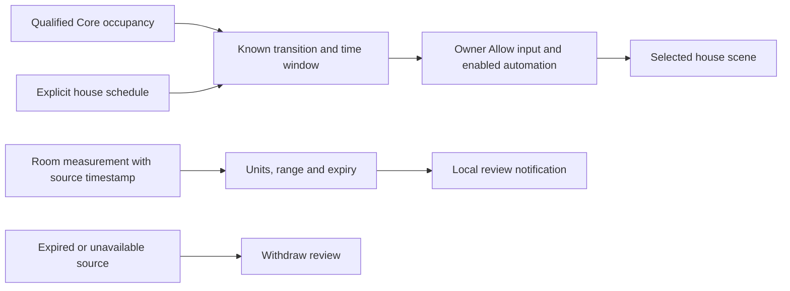

# House automation templates

These six Home Assistant blueprints are an opt-in starting point for qualified
house integrations. Installing a blueprint does not create an automation or
select a device. Every created automation starts **disabled**, and its separate
**Allow** input defaults to **off**. That input is checked inside the action
sequence as well as the normal conditions, so **Run actions** cannot skip it.

| Blueprint | Behavior after review and explicit activation |
| --- | --- |
| [Wind-down](blueprints/wind_down.yaml) | Activate a selected scene at a chosen Home Assistant local time. This is a separate house schedule, not the Pod's bedtime routine. |
| [Nighttime path](blueprints/night_path.yaml) | Activate a dim-light scene after a known occupied-to-empty transition lasts five seconds within the night window. |
| [Morning scene](blueprints/morning_scene.yaml) | Activate a scene after a known occupied-to-empty transition lasts thirty seconds within the morning window. This follows bed exit; it is **not** alarm synchronization. |
| [Empty bed](blueprints/empty_bed.yaml) | Activate a scene after both distinct sides have been continuously known empty for five minutes. |
| [Humidity review](blueprints/humidity_review.yaml) | Show one local review notification when a fresh measurement is outside the chosen band; withdraw it when recovered or expired. |
| [Air-quality review](blueprints/air_quality_review.yaml) | The same review behavior for PM2.5. Does not command a purifier. |

For HomePod temperature/humidity ingestion, see the separate
[Apple Home sensor-export setup](HOMEPOD_SENSOR_EXPORT.md). Its two reporting
blueprints use a virtual helper and cached-only MQTT reports; they do not run
house scenes or Pod actuators.

The four scene templates call only the selected `scene.turn_on`. They do not
publish MQTT commands, change temperature, move the base, vibrate, prime or power
the Pod. Keep Pod climate and actuators out of those scenes. Use a scene containing
only the intended, tested house accessories. There is no delayed restoration that
could overwrite a later manual change. The room reviews never call appliance
services: power-only diffusers and discrete purifier speeds must be qualified
before implementing appliance automation.



## Import and configure

Requires Home Assistant 2026.10 or later. Follow the official
[blueprint import workflow](https://www.home-assistant.io/docs/automation/using_blueprints/):

1. In **Settings → Automations & scenes → Blueprints → Import blueprint**, use a
   GitHub URL for one YAML file from a reviewed commit of this repository.
2. Create an automation from it and explicitly choose existing entities/scenes.
   Leave **Allow** off. Do not remove Apple Home or Homebridge pairings to obtain
   entities. The template does not provision broker accounts or pair devices.
3. For occupancy, use this fork's calibrated MQTT binary sensors after validating
   occupied, empty and unavailable behavior on the actual cover. Its discovery
   marks missing/stale readings unavailable and expires silent publishers. See
   [home telemetry](../../docs/HOME_TELEMETRY.md). Unavailable is never empty;
   unknown/unavailable-to-empty recovery does not trigger a scene.
4. Review the target scene using its normal controls, verify both platforms'
   timezones, then qualify one automation at a time while attended. Enable its
   **Allow** input and the automation itself only for that qualification.
5. Inspect Home Assistant traces and the physical accessory outcome separately.
   A successful service call does not prove a lamp, shade or speaker changed.

`initial_state: false` deliberately disables these qualification templates after
**every** automation reload or Home Assistant restart. After household acceptance,
an owner may take control of a blueprint automation and remove that line to use
Home Assistant's persisted enabled state. Removing it is a separate deployment
decision; this package never makes that change. See
[automation initial state](https://www.home-assistant.io/docs/automation/yaml/#automation-initial-state).

State-trigger hold timers reset across reloads/restarts; there is no catch-up.
The morning template cannot synchronize lights to a moved or skipped Pod alarm.
That requires a separately qualified wake-event integration. HomePod audio must
use a supported, owner-tested scene; these files do not expose its audio stream.

## Room review timestamps

Choose a real sensor with the exact unit `%` or `µg/m³`. Supply an attribute
whose integration documents **source measurement time**, including repeated
measurements with the same value. A Home Assistant receipt clock does not prove
a new physical measurement. `last_changed`, `last_updated` and `last_reported`
are rejected; do not replace them with `now()` or a derived clock.

ISO timestamps and numeric Unix seconds/milliseconds are supported. Missing,
malformed, future, expired, non-finite, wrong-unit and out-of-range data withdraw
the review instead of becoming zero. A state change or 30-second timer reevaluates
the original timestamp; it never rejuvenates cached data. Notifications use a
stable ID per automation, so repeated checks update one notice. The next timer
withdraws an expired notice within 30 seconds while Home Assistant and the
automation remain running. Disabled/stopped automations cannot retract an old
notice; the message therefore carries its source time and expiry. Dismiss it
manually if stopping the automation.

The initial bands are editable demonstration settings, not clinical thresholds,
air-quality assurances or a recommendation to run an appliance. These review
notifications are separate from the Pod's [room-context input](../../docs/ROOM_CONTEXT.md)
and do not enable comfort adaptation.

## Validation and remaining gates

Run on a development computer, **not on the Pod**:

```sh
uv run --project scripts/home-assistant --frozen python -m unittest discover \
  -s scripts/home-assistant -p 'test_*.py' -v
```

The locked test environment uses Home Assistant 2026.10.4 on Python 3.14. It
loads the real blueprint/automation/trigger schemas and executes Home Assistant's
script engine against synthetic states and stub scene/notification services.
The suite covers disabled/manual-run guards, time windows, known transitions,
two-side empty holds, source clocks, stale recovery and notification withdrawal.
No household data, real MQTT broker or physical devices are used in those tests.

Actual import, credentials/ACLs/TLS, source timestamp semantics, device selection,
Homebridge access, paired accessories, house restart behavior and physical
qualification remain deployment gates. No templates are enabled by a Git merge.
