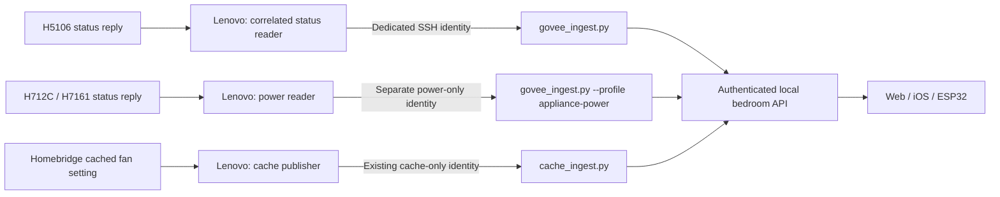

# Bedroom publishers

The cache publisher and the qualified Govee reader have separate identities and
forced commands. Neither identity permits a shell, temperature commands, history
reads, forwarding, or caller-selected source IDs. The Pod's general owner key
stays on the Pod. Existing Apple Home pairings are preserved.

## Qualified H5106 reads

`govee-reader.mjs` uses the already installed Homebridge Govee **11.39.1** account
certificate and dependencies. It opens a separate cloud connection and sends only
`status` requests, every 30 seconds. It does not create an account, change device
settings, or require Home Assistant/Pod MQTT. A plugin upgrade requires another
qualification rather than silently accepting a changed decoder.

Only a reply to this reader's pending transaction, from the configured H5106,
received within eight seconds, with `retain=false`, `dup=false`, QoS 0 and the
qualified three-frame layout is accepted. Each reply can be consumed once.
Disconnects and failed/expired requests withdraw the readings. Old receipts are
never replayed or given new timestamps. The receiver checks source ownership and
rejects reports delayed more than 15 seconds. At most one second of sender clock
skew is clamped backwards to the Pod's clock.

This establishes a **device read**, not a hardware measurement timestamp. The
API remains version 1: `timeBasis=device_read`, `measuredAt=null`. Neither a cloud
connection nor a cached HAP characteristic alone qualifies. Firmware can still
report its last sampled value, so physical freshness and environmental response
must be checked independently before relying on it for comfort control.

Temperature, relative humidity and PM2.5 come from the qualified response. The
fourth value is a **PM2.5-derived HomeKit air-quality category**, using the plugin's
bands: 1 at ≤12, 2 at ≤35, 3 at ≤75, 4 at ≤115, otherwise 5 µg/m³. It is not a
national AQI or a separate sensor. Zero particles are valid; cached category 0
still means unknown. Label this derived category in the source configuration.

Protocol references: [Govee AWS connection](https://github.com/homebridge-plugins/homebridge-govee/blob/v11.39.1/lib/connection/aws.js)
and [H5106 monitor decoding](https://github.com/homebridge-plugins/homebridge-govee/blob/v11.39.1/lib/device/sensor-monitor.js).
Synthetic test frames contain only the required layout and test values.

## Qualified appliance power

The `appliance-power` reader profile supports **H712C power** and **H7161 power**.
It shares one cloud connection between two independent status sessions, each
with its own pending transaction, timeout and publication queue. It requires
the matching model and device, a successful `state.result=1`, numeric `onOff`
of 0 or 1, and the qualified status-frame envelope (11 frames for H712C,
17 for H7161; canonical 20-byte frames with valid XOR checksums). Unknown
firmware layouts withdraw the value instead of guessing. The same eight-second
read and fifteen-second forwarding limits apply.

These are reported power states, not proof that a motor or diffuser physically
operated. The H712C's manual fan setting can be present even when another work
mode is selected; this profile does **not** promote it to current fan speed.
The cache publisher continues to label that setting as cached/display-only.
Protocol references are the installed provider's
[AWS status requests](https://github.com/homebridge-plugins/homebridge-govee/blob/v11.39.1/lib/connection/aws.js),
[H7126/H712C adapter](https://github.com/homebridge-plugins/homebridge-govee/blob/v11.39.1/lib/device/purifier-H7126.js)
and [H7161 adapter](https://github.com/homebridge-plugins/homebridge-govee/blob/v11.39.1/lib/device/diffuser-H7161.js).

Install with the same installer and pinned runtime hashes plus
`-ReaderProfile AppliancePower -PowerProtocolSha256 <sha256>`. It creates a separate
`govee-appliance-power` directory, SYSTEM task `FreeSleep-GoveeAppliancePower`
and `sleepypod-govee-power-read-only` key. The running H5106 task is untouched.
Authorize that new key only for `govee_ingest.py --profile appliance-power`,
using a root-only receiver configuration whose `devices` map contains exactly
`H712C` and `H7161`. Each device entry owns its internal `deviceId`,
`sources: {"power": "..."}` and `externalIds: {"power": "..."}`. The shared
`environment` path remains on the Pod. This key cannot submit monitor readings,
fan speed, arbitrary source IDs or commands; the monitor and cache keys retain
their narrower existing scopes.

Require recent successful observations from **both** appliances before running
`Set-GoveeReaderMode.ps1 -ReaderProfile AppliancePower -Mode Publish`. It transfers
only `govee-h712c-power` and `govee-h7161-power` out of the cache publisher,
preserving the fan setting. Verify each API observation, independent expiry,
recovery, and rejected shell commands. Existing active comfort policies and
hardware controls are outside this operation.

Rollback this profile with `-ReaderProfile AppliancePower -Mode Observe`. If both
profiles must be rolled back, restore appliance power **first**, then the
monitor profile: each handoff refuses externally changed configuration rather
than overwriting another publisher's source ownership.

## Installation and handoff

1. Keep the existing cache publisher running. Verify the Pod's comfort mode and
   enabled automation rules: this work does not authorize Active adaptation.
2. Run `Install-GoveeReader.ps1` in Administrator PowerShell with a pinned Git
   revision and SHA-256 hashes for its three `.mjs` files. Supply explicit
   `HomebridgeRoot` and `PluginRoot` paths if installing as another account. The
   SYSTEM task reads these paths, never SYSTEM's own empty profile.
3. Installation defaults to **observation only**. Inspect the private reader
   `status.json` and verify recurring correlated replies and plausible values.
   The installer preserves its key and refuses to overwrite a different active
   configuration or scheduled task. Private keys remain SYSTEM-owned.
4. Install `govee_ingest.py` in a root-owned, non-writable Pod directory. Create a
   root-only JSON configuration with `environment`, the internal `deviceId`, and
   `sources` / `externalIds` maps for `temperature`, `humidity`, `pm25`, and
   `airQuality`. Map these to the already configured H5106; no owner credential
   is copied to Windows. Add the new public key with `restrict`, the Lenovo's
   source address, and the forced Python `-I` receiver. Keep the old cache key
   cache-only. Check sshd configuration before reloading if required.
5. Verify that a command such as `id` is rejected by this new identity. A successful
   SSH login does not establish report acceptance.
6. Run `Set-GoveeReaderMode.ps1 -Mode Publish`. It requires a recent observation,
   saves both original configurations, stops both publishers, transfers the four
   H5106 sources, and restarts them. The old cache publisher retains appliance
   power/fan sources. A partial handoff is recoverable from its private manifest;
   unexpected external config changes stop the operation for review.
7. Verify four `device_read` sources and cached appliance state through the Pod
   API. Stop the reader long enough to verify expiry, then restart it and require
   a new reply. Test unavailable transitions and clock/replay rejection offline.
   Do not use synthetic sensor values on a real Pod.

Rollback: `Set-GoveeReaderMode.ps1 -Mode Observe` restores both exact original
configurations and resumes the cache-only monitor path. It does not change
Homebridge, Apple Home, saved routines, temperature, base, vibration, or MQTT.
Leave the unused separate identity disabled/revoke it if retiring the reader.

The current handoff supports the source IDs created by `Install-HomebridgeCache.ps1`.
It refuses an unknown mapping instead of guessing which device to replace.

## Validation

Run `node --test scripts/bedroom/*.test.mjs` and
`python3 -m unittest discover -s scripts/bedroom -p 'test_*.py' -v`.
Windows CI runs actual PowerShell 5.1 installation/task/ACL/recovery tests against
inert synthetic providers. That does not prove cloud or physical sensor behavior.
Live qualification records belong in private deployment evidence, not fixtures.
